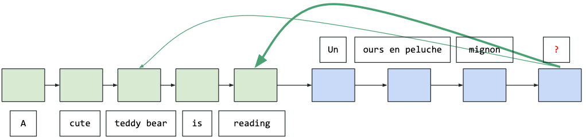
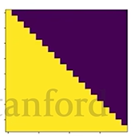

> [!NOTE] Stanford CME 295 筆記系列
> 1. **從 Attention 重新認識 Transformer (本篇)**
> 2. [LLM 的架構選擇，從 BERT、GPT 到 MoE 與 RoPE](/posts/cme295-lecture-2-large-language-models/)
> 3. [LLM 怎麼訓練，從 Pre-training 到 RLHF、GRPO](/posts/cme295-lecture-3-llm-training/)
> 4. [用 RL 訓練 LLM，從 REINFORCE、PPO 到 GRPO](/posts/cme295-lecture-4-rl-with-llms/)
>
> 文中示意圖皆取自或重繪自 [Stanford CME 295 課程簡報](https://cme295.stanford.edu/syllabus/)，版權歸原課程所有。

## BPE Tokenizer 與特殊 token

- BPE ([Byte Pair Encoding](https://arxiv.org/abs/1508.07909)) Tokenizer - 先有一組 Vocabulary，再透過訓練把訓練資料常常一起出現的 token 組合成新的 token 直至 vocabulary 達到預先設定的大小，這個方法的好處為 sequence 長度變短，因此能提高模型效率。
- 常見特殊 token (根據模型有很多種不同寫法)：
    - `[UNK]` - Unknown ("out of vocabulary")
    - `[BOS]` - Beginning of sequence
    - `[EOS]` - End of sequence
    - `[PAD]` - Padding，若 sequence 有固定長度時，可以填進去。

## 從 word2vec、RNN 到 Attention

word2vec 的主要問題是，同一字有很多意思、以及字出現的順序與 embedding 無關，而這些問題其實 RNN (記憶力太短，因為 vanishing gradient 讓 RNN「學不會」記住遠處的資訊)、LSTM (記憶變長了，但整段前文仍得擠進一個固定大小的狀態) 就有嘗試解，只是它們必須逐字循序計算、無法平行化，沒法像 Transformer 那樣靠 GPU 平行運算把模型和資料一路放大。

[Attention](https://arxiv.org/pdf/1409.0473) 在 2014 年被提出，主要是想解決 seq2seq 記不住輸入 sequence 的問題，所以讓模型在預測某個 token 時可以直連過去的 token embedding：

## Self-attention 與 Q、K、V

Transformer 使用的 self-attention 機制會考慮序列中的所有 token，也就是說，某個 token 的 representation 是所有 token，包括它自己的函數。
在 self-attention 中，每個 token 會被轉換成三個向量：query (Q，代表「我要找什麼」)、key (K，代表「我能提供什麼」) 和 value (V，代表「我實際的內容」)。要計算某個 token 的 representation 時，模型就會拿它的 query 去和每個 token (包括它自己) 的 key 比對相似度，得出該分給每個 token 多少注意力，再依這些比例把所有 token 的 value 加權相加。
因為這些比例是依內容動態算出來的，所以同一個字在不同上下文中會得到不同的 representation。

## Decoder 的三個 sub-layer

Transformer 的 Decoder 由多個相同的 layer 疊成，每個 layer 內有三個 sub-layer。
第一個是 masked multi-head attention，輸入是 `[BOS]` 加上目前為止生成的 token (訓練時則是整段目標句右移一格，靠 mask 讓每個位置只看得到自己和前面的 token，以便平行計算，雖然這個右移很像是為 `[BOS]` 騰位置，但實際目的是讓每個位置的「輸入」和「要預測的答案」錯開一格，用翻譯成「我 愛 你」來看。目標序列 (也就是答案) 是「我 愛 你 `[EOS]`」，右移後的 decoder 輸入是「`[BOS]` 我 愛 你」。兩者逐位置對齊後，第 1 個位置看到 `[BOS]`，要預測「我」；第 2 個位置看到「`[BOS]` 我」，要預測「愛」；第 3 個位置看到「`[BOS]` 我 愛」，要預測「你」；第 4 個位置看到「`[BOS]` 我 愛 你」，要預測 `[EOS]`)。
第二個是 encoder-decoder attention，也就是 cross-attention，因為原本的 Transformer 是為機器翻譯設計的，這個 sub-layer 的目的是讓目標語言這邊的 token 和原語言的 token 互動。
原論文圖中指向它的三條箭頭，一條來自前一個 sub-layer 的輸出，提供 query；另外兩條來自 encoder 最後一層的輸出，提供 key 和 value。
概念上，這是每個 decoder token 拿自己的 query 去「問」原文：原文中哪些 token 跟我現在要生成的東西最相關？模型用 query 和原文各 token 的 key 算出權重，再對原文 token 的 value 加權相加，把這份從原文取來的資訊加回該 token 原本的 representation 上。
第三個 sub-layer 則是 feed-forward network。

## Transformer 的計算技巧

Transformer 還有幾個計算上的小技巧：

### 殘差連接 (residual connection，模型架構圖中的 Add)

每個 sub-layer 的輸出是 $x + \text{Sublayer}(x)$，也就是把輸入以 element-wise 的方式直接加到輸出上。
這讓梯度可以沿著這條「捷徑」直接往回傳，不必穿過每一層的權重，深層網路比較不會訓練失敗；同時每個 sub-layer 只需要學「要在原本的 representation 上補什麼」，下層的資訊也不會在層層轉換中流失。

### Layer normalization (模型架構圖中的 Norm)

對每個 token 的向量，沿著特徵維度減去平均、除以標準差，再乘上可學習的縮放、加上可學習的偏移。原論文的寫法是 $\text{LayerNorm}(x + \text{Sublayer}(x))$。
它讓每一層輸出的數值尺度保持穩定，訓練收斂得更快更穩；而且它只在單一 token 內部計算，不依賴 batch 中的其他樣本或序列長度，適合長短不一的文字序列。

### Masking

在 attention 的 softmax 之前，把不該看到的位置的分數設成 $-\infty$，softmax 後這些位置的權重就變成 0。
Decoder 的 self-attention 用的是 causal mask，它是一個上三角矩陣，讓第 $i$ 個位置只能看到自己和前面的 token：

好處是訓練時整段目標句可以一次用矩陣運算平行算完，同時保證每個位置都不會偷看到後面的答案。(另外還有 padding mask，用來忽略 batch 裡為了對齊長度而補上的空白 token。)

### Multi-head attention

把 Q、K、V 分別用不同的投影矩陣投影成 $h$ 組較小的向量 (原論文 $h = 8$，每組 64 維)，各自獨立做 attention，再把結果串接起來、乘上一個輸出矩陣。
因為每個 head 的維度變小，總計算量和用一個完整維度的 head 差不多。單一 head 的 softmax 只能給出一種注意力分配，多個 head 則讓模型能同時關注不同位置、不同種類的關係 (例如一個 head 看語法依存、另一個看指代)，概念上類似 CNN 用多個 filter 抓不同特徵。

### Dropout

訓練時以機率 $p$ 把部分神經元的輸出隨機設成 0 (原論文 $p = 0.1$)，套用在每個 sub-layer 的輸出 (加回殘差之前)，以及 embedding 加上 positional encoding 之後。
這迫使模型不能依賴少數特定神經元，效果類似同時訓練許多子網路再取平均，因此泛化得更好。推論時則關閉 dropout。

### Label smoothing

把訓練目標從 one-hot 分布改成稍微「軟化」的分布，$q(k|x) = \delta_{k,y} \rightarrow q'(k|x) = (1-\epsilon)\,\delta_{k,y} + \epsilon\,u(k)$，其中 $u(k)$ 是均勻分布、原論文 $\epsilon = 0.1$。
也就是正確答案的目標機率從 1 降到約 0.9，剩下的機率平均分給其他字。
這能防止模型為了把正確答案的機率推到 1 而讓 logits 無限放大、變得過度自信，是一種正則化，也讓模型輸出的機率更貼近實際的正確率 (即 calibration 較好)。
原論文指出它會讓 perplexity 變差 (因為模型學得比較不確定)，但 accuracy 和 BLEU 分數會提升。
