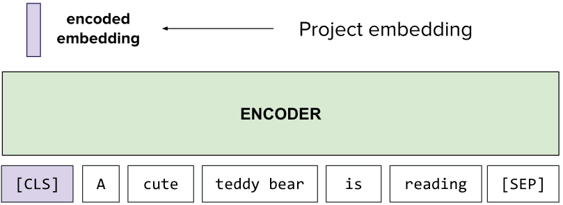
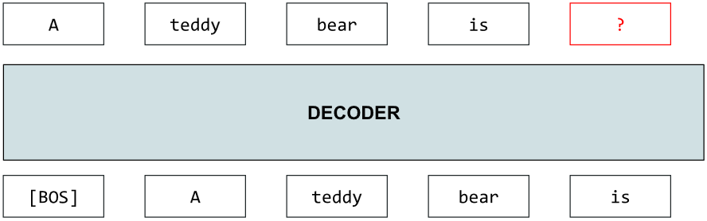
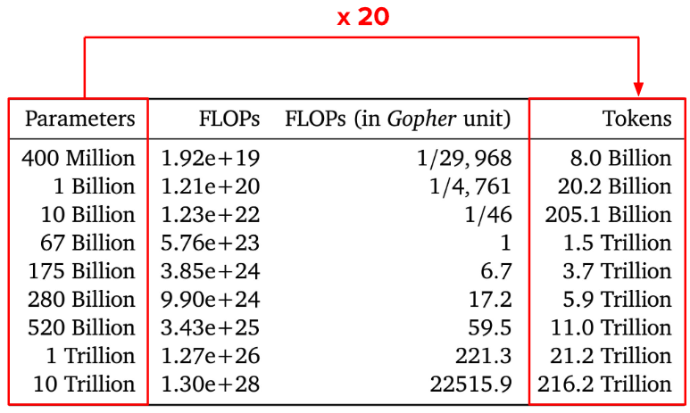
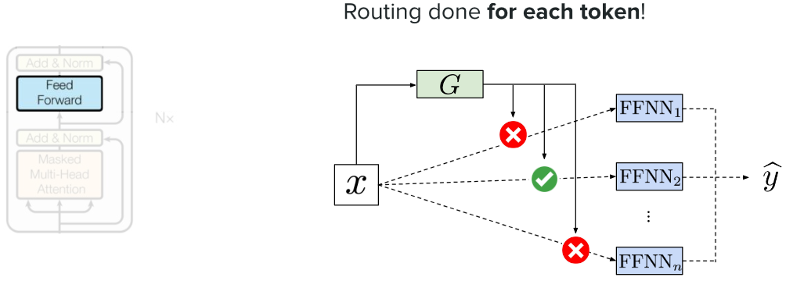
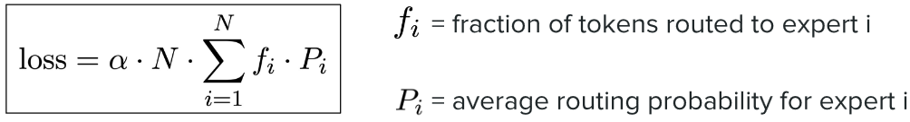
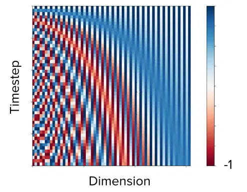
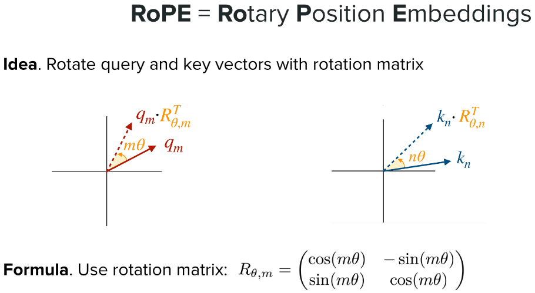
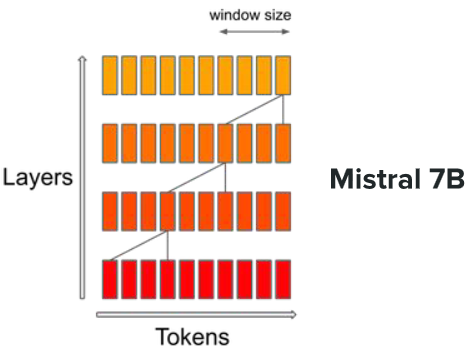
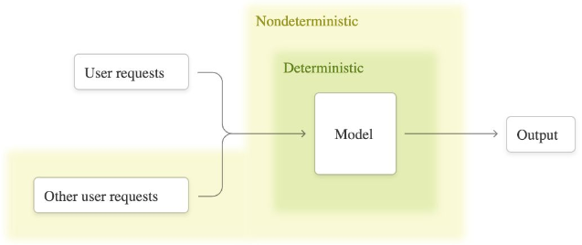
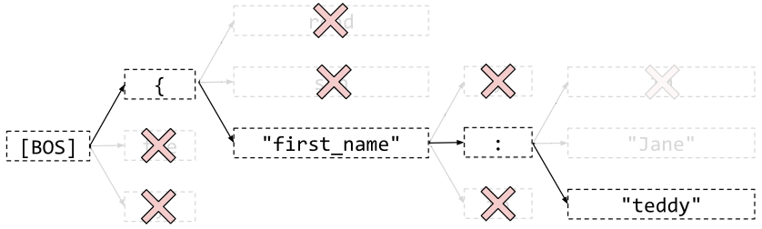

> [!NOTE] Stanford CME 295 筆記系列
> 1. [從 Attention 重新認識 Transformer](/posts/cme295-lecture-1-transformers/)
> 2. **LLM 的架構選擇，從 BERT、GPT 到 MoE 與 RoPE (本篇)**
> 3. [LLM 怎麼訓練，從 Pre-training 到 RLHF、GRPO](/posts/cme295-lecture-3-llm-training/)

## 從 BERT 到 GPT

[BERT](https://arxiv.org/abs/1810.04805) (Bidirectional Encoder Representation from Transformers) - Encoder-only，透過 encoded embeddings 來做預測。

- 訓練步驟：
    1. Pre-training: 使用 proxy tasks 做預訓練，目標是讓模型理解文本，BERT 試了兩種 proxy task：
        - MLM (Masked Language Model)，尺度以句子為單位，讓模型透過克漏字，學會 Token 怎麼排序，使用的 embeddings 來自 `[MASK]` Token。
        - NSP (Next Sentence Prediction)，尺度以文本為單位，讓模型透過回答兩個句子是否為連續的語句，學會句子怎麼排序，使用的 embeddings 來自 `[CLS]` Token。
    2. Fine-tuning: 以最終的任務進行微調。
- 優點是表現好、微調不需要一堆資料，但缺點是微調是必要的步驟且有些任務不能用 (例如文本生成，直到 Lecture 8 )。

[GPT](https://cdn.openai.com/research-covers/language-unsupervised/language_understanding_paper.pdf) (Generative Pre-trained Transformer) - Decoder-only，以 auto-regressive 方式一次生成一個 token。

- **GPT-1**：先用大量無標註文字做 language modeling pre-training，再針對下游任務 fine-tune。
  不同任務透過 input transformation 改寫成單一序列，再接上 task-specific 的 linear head。
- **GPT-2 / GPT-3**：把所有任務都視為 language modeling 問題，靠 prompt 描述任務，因此可以做到 zero-shot 或 few-shot，fine-tuning 不再是必要步驟。
  例如想做分類，就在 prompt 裡描述任務，讓模型直接生成類別名稱。這個「文字進、文字出」的統一介面，概念上和 T5 的 text-to-text 殊途同歸。

## Chinchilla：模型尺寸與訓練 Token 的甜蜜點

在論文 [Training Compute-Optimal Large Language Models](https://arxiv.org/abs/2203.15556) (Chinchilla) 中提到，模型尺寸與訓練所需 Token 的甜蜜點大約在一個參數對應到 20 個 Token：

## Mixture of Experts (MoE)

### Dense 與 Sparse MoE

MoE (Mixture of Experts) 的概念起源來自於以下問題：我真的需要 LLM 裡面所有的權重來回答我的問題嗎？如果我只 activate 一部分權重呢？就像是我該去問專家，還是問所有人？

- Dense MoE - 輸出為「所有」專家的加權平均，$\hat{y}=\sum^n_{i=1}G(x)_i E_i(x)$，其中 $G$ 為 Gate，$E$ 為 Experts。
- Sparse MoE - 較省，所以是主流，輸出為「被選中 (top-k)」專家的加權平均，$\hat{y}=\sum_{i \in I_k}G(x)_i E_i(x)$。

而把 MoE 的概念帶入 LLM，就是在 FFN 層由 router 為每個 token 做 routing，挑出最適合處理它的少數幾個專家：

### Routing collapse 與 auxiliary loss

可一旦模型引入 routing，訓練時就容易遇到 routing collapse：router 逐漸偏好少數幾個專家，這些專家拿到更多訓練而變得更強，又更容易被選中，其他專家則幾乎沒有被訓練到。
常見的解法是加入 auxiliary loss (load balancing loss)，當 token 過度集中在少數專家時就給予懲罰，鼓勵 router 把 token 分配得更平均，讓其他專家也有機會「上場」被訓練到。
以 Switch Transformer 為例，這個 loss 定義如下：

其中 $N$ 是專家數量，$f_i$ 是這個 batch 裡實際被分派給第 $i$ 個專家的 token 比例，$P_i$ 則是 router 分給第 $i$ 個專家的平均機率。

> [!NOTE] auxiliary loss 的有趣之處
>  - **為什麼要同時用 $f_i$ 和 $P_i$？** $f_i$ 是根據 top-k 的選擇結果去「數」的，這個操作不可微分，梯度傳不回去。$P_i$ 是 router 輸出的 softmax 機率，可以微分。
>    兩者相乘之後，$f_i$ 負責反映「實際上分配得多不平均」，$P_i$ 負責提供梯度，讓 router 真的能被調整。
>  - **為什麼平均分配時 loss 最小？** 當 token 完全平均分配時，每個 $f_i$ 和 $P_i$ 都是 $1/N$，總和是 $N \times (1/N)^2 = 1/N$。乘上前面的 $N$ 之後剛好等於 1，所以 loss 就是 $\alpha$。
>    一旦分配不平均，被偏好的專家會同時有較大的 $f_i$ 和 $P_i$，相乘後讓總和變大。前面那個 $N$ 的作用就是把最小值固定在 $\alpha$，讓專家數量改變時，這個 loss 的尺度不會跟著變。
>  - **α 怎麼選？** 這裡就是接 trade-off 的位置：α 太小壓不住 collapse，太大則會干擾模型的主要學習目標。Switch Transformer 論文裡用的是 $\alpha = 10^{-2}$。

### DeepSeekMoE：讓專家真正專精

[DeepSeekMoE](https://arxiv.org/abs/2401.06066) 關心的是另一個問題：就算 token 分配平均了，專家真的有「專精」嗎？
傳統 MoE (如 GShard) 從 $N$ 個專家裡選 top-$K$，專家數量少、每個又很大，於是一個專家被迫同時學好幾種不相干的知識 (knowledge hybridity)，不同專家之間又會重複學到同樣的共通知識 (knowledge redundancy)。
DeepSeekMoE 用兩個架構上的改動來處理：

- **Fine-grained expert segmentation** - 把每個專家拆成 $m$ 個更小的專家 (FFN 的 hidden dimension 縮成 $1/m$)，從 $mN$ 個裡啟用 $mK$ 個。計算量不變，但可選的專家組合大幅增加，讓知識能被切得更細。
  例如 $N=16, K=2$ 只有 $\binom{16}{2}=120$ 種組合；$m=4$ 之後變成 $\binom{64}{8}$，約 44 億種。
- **Shared expert isolation** - 另外隔離出 $K_s$ 個 shared experts，每個 token 都一定會經過，專門吸收共通知識，讓 routed experts 不必各自重複學。為了維持計算量，routed experts 的啟用數量會相應減少 $K_s$ 個。

輸出因此變成 shared 和 routed 兩部分相加：$h = \sum_{i \in \text{shared}} E_i(u) + \sum_{i \in \text{routed}} G(u)_i E_i(u) + u$，最後的 $u$ 是 residual connection。
值得注意的是，DeepSeekMoE 仍然沿用 auxiliary loss，並且分成 expert-level 和 device-level 兩種，前者就是 Switch Transformer 那條公式的變體，後者則是為了平衡不同 GPU 之間的計算負載。

## 位置編碼：從 sinusoidal 到 RoPE

### 原始 Position Encoding

Position Encoding 原始版本的目的在於，表達 token 在句子中的位置，而且位置近的兩個 token 要 similarity 要比位置遠的高。

$$
PE_{(pos, 2i)} = \sin\left(\frac{pos}{10000^{2i/d}}\right), \quad PE_{(pos, 2i+1)} = \cos\left(\frac{pos}{10000^{2i/d}}\right)
$$

其數學直覺就是維度 index 越小的 P.E. 頻率越高 (sin 或 cos 隨位置變化得越快)，每一對相鄰維度 $(2i, 2i+1)$ 共用同一個頻率，一個用 sin、一個用 cos。
也就是說，每個位置會有一個 $d$ 維 P.E. ，而每一個維度的數值是由 sin, cos 交錯而來，除此之外，**頻率還每兩個維度降一次**。

對照上圖，縱軸 Timestep 是位置 $pos$，橫軸 Dimension 是維度索引。
最左邊的 column 頻率最高，相鄰位置之間就藍紅交替；越往右頻率越低，顏色變化越慢，到最右邊幾乎整條都是同一個顏色。
也就是說，每個維度負責分辨的距離尺度不同：高頻維度分辨相鄰幾步的差異，低頻維度分辨遠距離的差異，合起來讓每個位置都有唯一的編碼。
至於為什麼近的 similarity 比較高，可以直接把兩個位置的 P.E. 做內積，每一對 sin/cos 貢獻的是 $\sin a \sin b + \cos a \cos b = \cos(a-b)$，所以：

$$
PE(pos) \cdot PE(pos+k) = \sum_i \cos(k \cdot \omega_i), \quad \omega_i = \frac{1}{10000^{2i/d}}
$$

結果只和距離 $k$ 有關，和絕對位置無關。
$k$ 很小時，所有 $\cos(k\omega_i)$ 都接近 1，內積很大；$k$ 變大後，高頻項開始互相抵銷，只剩低頻項維持接近 1，內積就隨距離大致遞減 (並非嚴格單調，會帶一些震盪)。
另外，用 sin/cos 成對的好處在於：位置 $pos+k$ 的編碼，可以由 $pos$ 的編碼乘上一個只和 $k$ 有關的旋轉矩陣得到。
換句話說，相對位移在每個頻率上都是一個固定角度的旋轉，模型比較容易從中學到相對位置關係。
這個「把位置當成旋轉」的想法，後來被 [RoPE](https://arxiv.org/abs/2104.09864) 直接拿來用在 attention 的 query 和 key 上。

> [!NOTE] 為什麼內積會是每一對 sin/cos 貢獻的是 $\sin a \sin b + \cos a \cos b = \cos(a-b)$
> 因為內積是「同一個維度相乘，再全部加起來」，而 P.E. 的維度剛好是兩兩成對的，而且這個「剛好」其實是刻意設計的，讓同一頻率的 sin 和 cos 可以被放在一組。
> 先把內積按維度展開，$d$ 維向量的內積是 $\sum_{j=0}^{d-1} PE(pos)_j \cdot PE(pos+k)_j$，我們把這 $d$ 項兩個兩個分組，第 $i$ 組就是維度 $2i$ 和 $2i+1$。
> 再看第 $i$ 組裡面有什麼，令 $a = pos \cdot \omega_i$、$b = (pos+k) \cdot \omega_i$，那麼：
> - 位置 $pos$ 在這兩個維度上的值是 $(\sin a, \cos a)$
> - 位置 $pos+k$ 在這兩個維度上的值是 $(\sin b, \cos b)$
>   
> 同維度相乘再相加，這一組的貢獻就是 $\sin a \sin b + \cos a \cos b$。
> 接著套三角恆等式，餘弦的差角公式是：$\cos(a-b) = \cos a \cos b + \sin a \sin b$
> 右邊剛好就是上面那一組的貢獻，所以它等於 $\cos(a-b)$，而 $a - b = -k\omega_i$，cos 是偶函數，正負號不影響，於是得到 $\cos(k\omega_i)$。$pos$ 在相減時消掉了，這就是為什麼結果只和距離 $k$ 有關。
> 最後把所有組加起來，就是 $\sum_i \cos(k\omega_i)$。
> **幾何上看會更直觀。**
> $(\sin a, \cos a)$ 是單位圓上角度 $a$ 的點，$(\sin b, \cos b)$ 是角度 $b$ 的點，兩個都是長度為 1 的向量。
> 兩個單位向量的內積就是它們夾角的 cos，而夾角就是 $a - b$。所以每一對 sin/cos 其實是一根以頻率 $\omega_i$ 旋轉的指針，位置差 $k$ 讓兩根指針差了 $k\omega_i$ 的角度，內積只是在量這個角度差。
> 這也是前面說「相對位移是一個固定角度的旋轉」的同一件事。

### RoPE：把位置變成旋轉

原版 PE 是把位置向量**加**到 token embedding 上，相對位置的性質只存在於「PE 和 PE 的內積」裡，一旦和 embedding 相加、再經過 $W_Q$、$W_K$ 投影，這個乾淨的結構就被打亂了。RoPE 則是直接把 query 和 key 的每一對維度，**旋轉**一個 $pos \cdot \theta_i$ 的角度，頻率 $\theta_i = 10000^{-2i/d}$ 和原版一模一樣。
這樣算 $q \cdot k$ 時，兩個旋轉角度相減，絕對位置消掉，attention score 就只依賴相對距離，和剛剛用差角公式推出來的是同一件事，只是發生的地方從 PE 本身搬到了 attention 裡。

## Attention 變體

### Sliding Window Attention (SWA)

SWA (Sliding Window Attention) 雖然每層只看固定大小的 window，但不會像 RNN 那樣嚴重遺忘遠處的資訊，原因和 CNN 疊加多個卷積層相同：多個 attention block 疊加後，上層 token 能間接看到的範圍會等效地變大，疊 $L$ 層後理論感受野約為 $W \times L$，見下圖。

不過這個能力有其極限：超過 $W \times L$ 的 token 完全看不到，而遠距離資訊必須經過中間 token 層層轉手，仍會被稀釋。因此實務上常讓 SWA 和全域 attention 層交錯使用。

### MHA、MQA 與 GQA：共用 K、V

MHA (Multi-Head Attention) 中每個 head 都有自己的 Q、K、V 投影。
為了減少 decoding 時 KV cache 的記憶體與頻寬成本，MQA (Multi-Query Attention) 讓所有 head 共用同一組 K、V，GQA (Group-Query Attention) 則把 head 分組、同組內共用。  
共用 K、V 之所以可行，是因為每個 head 仍保有自己的 Q：不同的 query 和同一組 key 比對，會得到不同的 attention 分布，從同一組 value 中取出不同的組合。
代價是各 head 無法再把 token 投影到專屬的 K、V 子空間，MQA 因此會有品質損失，GQA 則在品質與成本之間取得折衷。

> [!NOTE] Q, K, V 直觀理解
> Q 是「我在找什麼」，K 是「我身上貼的標籤，用來被比對」，V 是「如果你選中我，我實際交給你的內容」。
> 以圖書館類比，Q 是讀者的查詢，K 是每本書的索引卡，V 是書的內容。
> Q 和 K 做內積，算出「這個查詢和每張索引卡有多匹配」，得到 attention weights；再用這組權重把 V 加權平均起來，就是這個 head 的輸出。

## Normalization 的位置與選擇

原版 Transformer 採用 Post-Norm，$x_{l+1} = \text{LN}(x_l + F(x_l))$，其中 $F$ 是一個 sublayer (attention 或 FFN)，LayerNorm 放在加上 residual 之後，使得 residual 路徑上串了一連串 LN，不再是單純的恆等映射，梯度無法乾淨地流回淺層，訓練必須依賴 warmup，層數越深越不穩。Pre-Norm 改成 $x_{l+1} = x_l + F(\text{LN}(x_l))$，在 attention 和 FFN 之前先做 normalize，讓 residual 路徑保持乾淨，訓練穩定許多，因此成為現代 LLM 的標準做法。
代價是 residual stream 一路累加不被 normalize，深層的貢獻會被稀釋，且需要在最後一個 block 之後補一個 final LayerNorm。
此外，現代 LLM 多半還會把 LayerNorm 換成更便宜的 RMSNorm (名字來自 Root Mean Square)，公式裡的 $\odot$ 是逐元素相乘，$\gamma$ 是可學習的縮放參數：

$$
\text{LayerNorm}(x) = \gamma \odot \frac{x - \mu}{\sigma} + \beta, \qquad \text{RMSNorm}(x) = \gamma \odot \frac{x}{\text{RMS}(x)}, \quad \text{RMS}(x) = \sqrt{\frac{1}{d}\sum_{i=1}^{d} x_i^2}
$$

RMSNorm 拿掉了減去平均值 (re-centering) 和偏移項 $\beta$，只保留縮放 (re-scaling)。
少算一次平均值，計算量和參數都更少，而實驗顯示穩定訓練的關鍵主要來自縮放，拿掉 re-centering 幾乎不影響效果。

若把 LN 放在 sublayer 與 residual 之間，$x_{l+1} = x_l + \text{LN}(F(x_l))$，雖然 residual 路徑同樣乾淨，但 sublayer 的輸入沒有被 normalize，會隨著 residual stream 的累加而量級漂移。
因此實務上會和 Pre-Norm 搭配使用，即 Sandwich-Norm：$x_{l+1} = x_l + \text{LN}(F(\text{LN}(x_l)))$，前者穩定 sublayer 的輸入，後者控制每一層寫回 residual stream 的量，Gemma 2/3 即採用此設計。

## Decoding 策略

### 從 greedy 到取樣：top-k 與 top-p

如果 LLM 每一步都選最高機率的 token (greedy)，或用 beam search 找最高機率的序列，生成結果會過於 deterministic，在開放式生成中容易變得平淡、甚至陷入重複。這是因為人類的文字本來就不是每一步都挑最可能的詞。
因此改成從機率分布中取樣，會得到更像人的回答。
但直接從完整分布取樣，容易抽到尾端不相干的 token，所以實務上會先用 top-k (只從機率最高的 $k$ 個裡抽) 或 top-p (只從累積機率達到 $p$ 的最小集合裡抽) 截掉低機率的部分再取樣，並搭配 temperature 控制隨機程度。

### Temperature 與 T = 0 的非確定性

Temperature $T$ 位於 softmax 指數項的分母：

$$
p_i = \frac{e^{z_i/T}}{\sum_j e^{z_j/T}}
$$

因此 $T$ 越小，機率分布越尖銳，集中在最高機率的 token，反之則越均勻。  
也就是說，$T=0$ 在實作上等同 greedy decoding (取 argmax)，理論上應該是 deterministic，但實務上仍會得到不同結果。
原因並非一般認為的 GPU 平行運算加上浮點數非結合律，而是 inference kernel 缺乏 batch invariance：請求會和其他人的請求併成 batch，batch size 隨伺服器負載變動，而 kernel 的數值結果會隨 batch size 改變。
詳見 [Defeating Nondeterminism in LLM Inference](https://thinkingmachines.ai/blog/defeating-nondeterminism-in-llm-inference/)。

### Guided decoding：強制輸出格式

如果想要輸出嚴格符合指定格式 (例如 JSON schema 或 regex)，可以考慮 guided decoding (也稱 constrained decoding)：每一步生成時，把會破壞格式的 token 遮蔽掉 (logit 設為 $-\infty$)，只從合法的 token 中選擇。
注意，它保證的是結構合法，而非 deterministic：在同一個格式下，內容仍可能隨取樣而不同，但代價是強制格式有時會把模型推向低機率的路徑，影響內容品質。

## Context window 與 output 上限

Context window 是模型一次能處理的 token 總數，input (prompt) 和 output 共用這個空間，所以 $\text{input} + \text{output} \le \text{context window}$。
這是因為 auto-regressive 生成時，每產生一個 output token 都會接回序列後面、成為下一步的輸入，模型必須同時 attend 到原本的 prompt 和已經生成的內容。
因此 input 實際可用的長度 ≈ context window − 預留給 output 的空間；在多輪對話中，先前的對話紀錄也會一併算進 input。
Output token limit 則是另外設的上限，通常遠小於 context window，要注意的是，它並不是架構上的硬限制：模型看到的只是一條序列，理論上可以一直生成到填滿 context window 為止。
這個上限實際上由兩類因素共同決定：

- 服務成本：decoding 是逐 token 依序進行的，output 越長，請求佔用 GPU 和 KV cache 的時間就越久，也越容易逾時，設上限便於服務端排程與預估資源。
- 模型能力：模型在訓練時看到的多半是長度有限的回答，強行生成過長的內容，後段容易出現重複、離題或結構崩壞。

Output limit 某種程度反映了模型能穩定產出的長度，這也是為什麼強調長推理的模型，output limit 通常明顯較高。

- [Context Rot: How Increasing Input Tokens Impacts LLM Performance](https://www.trychroma.com/research/context-rot)

## In-context learning 與 CoT 的演進

Few-shot in-context learning 在近期越來越少被當作預設做法，CoT 的演進正好說明了這個轉變：

- **Few-shot CoT**：[Chain-of-Thought Prompting](https://arxiv.org/abs/2201.11903)  (Wei et al., 2022) 在 prompt 中提供幾個附有中間推理步驟的範例，引導模型先推理再回答，大幅提升數學、常識與符號推理的表現。這個能力只在規模夠大的模型上才會浮現。
- **Zero-shot CoT**：[Kojima et al.](https://arxiv.org/abs/2205.11916) (2022) 發現不需要範例，只要加上 "Let's think step by step" 就能引出推理，顯示模型本身已具備這個能力，範例只是觸發方式之一。
- **推理模型**：透過訓練把 CoT 內化，模型會自行先推理再回答，few-shot 不但不必要，甚至可能降低表現 (DeepSeek-R1 的論文即指出這點)。

而這背後的共同原因是：早期 base model 只學過 next-token prediction，看到一段指令只會當成普通文字接續下去，不知道要去執行它，因此需要用範例把任務包裝成「照模式接下去」的形式。
後來經過 instruction tuning 與 RLHF，模型學會「指令之後應該接上完成指令的內容」，光靠文字描述就能理解並執行任務。
此外，模型容易過度模仿範例的表面特徵，例如長度、句型與用詞，因此現在常見的 prompt engineering 做法，是把範例背後的規則歸納成明確的 instruction。
不過當目標格式或風格難以用文字描述時，few-shot 仍然有效，此時應提供多樣的範例，並說明它們僅供參考。
