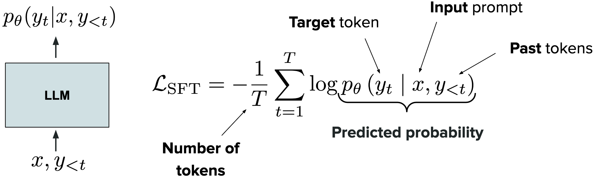
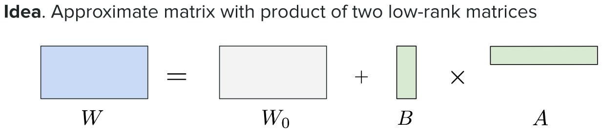
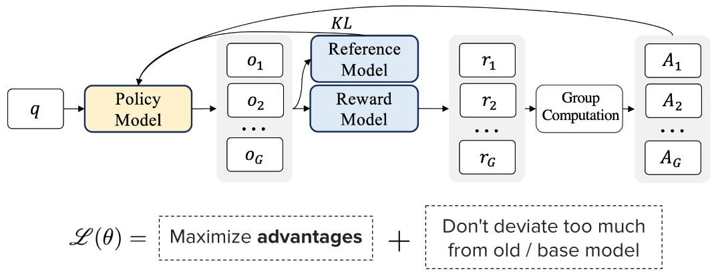

> [!NOTE] Stanford CME 295 筆記系列
> 1. [從 Attention 重新認識 Transformer](/posts/cme295-lecture-1-transformers/)
> 2. [LLM 的架構選擇，從 BERT、GPT 到 MoE 與 RoPE](/posts/cme295-lecture-2-large-language-models/)
> 3. **LLM 怎麼訓練，從 Pre-training 到 RLHF、GRPO (本篇)**

## 遷移學習：從 pre-training 到 fine-tuning

因為 NLP 的許多任務都共享相同的基礎知識 (例如語法、詞義和常識)，與其每個任務都用大量標註資料從頭訓練，不如先學一次通用知識，再轉移到各個具體任務上，也就是所謂的 transfer learning。
在 LLM 中，這個流程分成兩個階段：

- **Pre-training**：在大量無標註文字上以 self-supervised 的方式 (next-token prediction) 學習通用的語言知識。因為不需要人工標註，資料規模可以推得極大。
  而且訓練時採用 teacher forcing，每個位置都以訓練資料中的正確 token 作為前文 (Input)，不必等待模型自己的預測，搭配 Transformer 的 causal mask (每個位置只能 attend 自己和前面的 token，看不到後面要預測的答案)，一段序列的所有位置可以在一次 forward pass 中平行計算，讓大規模訓練在計算上也可行。
- **Fine-tuning**：在特定下游任務的少量標註資料上繼續訓練，把通用知識轉移到該任務。

注意，到了 GPT-2、GPT-3 之後，第二階段也可以改用 prompting 或 in-context learning，不更新參數就直接使用 pre-trained model，仍可視為廣義的 transfer learning。

## Cross Entropy 與最大概似估計

Cross Entropy 從第一原理看，就是 maximum likelihood estimation：找出參數 $\theta$，使模型對訓練資料賦予的機率最大。

> [!NOTE] Entropy 的心智模型
> 更直觀的看法是從「驚訝程度」出發。
> 一個機率為 $p$ 的事件發生時，我們的驚訝程度定義為 $\log \frac{1}{p}$：機率越低越驚訝，而且兩個獨立事件同時發生時，機率相乘、驚訝應該相加，log 剛好把乘法轉成加法，因此選它作為驚訝的基本單位。
> Entropy 就是在已知真實分布 $P$ 的情況下，平均會感到多驚訝，其中 $s$ 為所有可能的狀態：
> $$
> H(P) = \sum_s p_s \log \frac{1}{p_s}
> $$
> 它衡量的是 $P$ 本身的不確定性，是再怎麼準確的預測都無法消除的驚訝。
> 但現實中我們拿不到真實分布 $P$，只能用一個信念 $Q$ (也就是模型) 去預測，事件仍然按照 $P$ 發生，但我們的驚訝程度是根據自己的信念 $Q$ 來計算的，這就是 **Cross-Entropy**：
> $$
> H(P, Q) = \sum_s p_s \log \frac{1}{q_s}
> $$
> 如果 $P = Q$，代表模型完美，此時 cross-entropy 就等於 entropy；而只要 $Q \neq P$，cross-entropy 一定大於 entropy，多出來的驚訝都來自信念錯誤。
> 所以驚訝有兩個來源：一是過程本身的不確定性 $H(P)$，二是相信了錯誤模型所付出的代價，後者單獨拿出來就是 KL Divergence：
> $$
> D_{KL}(P \,\|\, Q) = H(P, Q) - H(P) = \sum_s p_s \log \frac{p_s}{q_s}
> $$
> 訓練時，$H(P)$ 由資料決定、與模型參數無關，因此最小化 cross-entropy 就等於最小化 KL divergence，也就是讓模型的信念盡量貼近真實分布。
> 回到 LLM 訓練：每個位置的真實分布 $P$ 是 one-hot，只有實際出現的下一個 token 機率為 1，代入後 cross-entropy 只剩一項 $-\log P_\theta(x_t \mid x_{<t})$，也就是模型看到正確答案時的驚訝程度。
> 把所有位置加總，正好是訓練資料 likelihood 取 log 再加負號，因此最小化 cross-entropy 就等於最大化 likelihood。

## Pre-training 的 Data Mixture

pre-training 資料來自多種來源 (網頁、程式碼、論文、數學、百科等)，data mixture 決定每個來源在訓練資料中佔多少比例、是否重複使用，以及如何依品質取捨。

- [Scaling Data-Constrained Language Models](https://arxiv.org/abs/2305.16264) - [Chinchilla](https://arxiv.org/abs/2203.15556) (Hoffmann et al., 2022) 提出 compute-optimal 的 scaling law：在固定 compute 下，模型參數量與訓練 token 數應等比例增加，大約每個參數對應 20 個 token。但它預設每個 token 都是全新的資料，沒有考慮資料用完的情況。
  這篇論文修正了這個假設：在資料有限、compute 固定的情況下，同一份資料重複訓練 4 個 epoch 以內，loss 和使用全新資料幾乎沒有差別；超過之後，重複 token 的價值隨重複次數快速遞減，繼續增加 compute 的收益最終趨近於零。論文據此提出把「重複 token 價值遞減」納入考量的 scaling law。
  此外，當自然語言資料不足時，用 code 資料 (程式碼) 補足 token 數量並不會損害自然語言任務的表現，放寬原本的過濾條件也是可行的補救手段。
  註：LLM pre-training 通常大部分資料只看過一次 (不到 1 個 epoch)，這篇論文關注的是未來高品質資料耗盡時，重複使用舊資料是否仍有價值。
- [DataComp-LM (DCLM)](https://arxiv.org/abs/2406.11794) - 過去的開源資料集 (如 C4、The Pile、RefinedWeb) 各自用不同的處理流程，搭配不同的模型與訓練設定，即使最後表現有差異，也很難判斷是資料造成的，還是模型或訓練方式造成的。
  DCLM 提供一個受控的實驗平台：固定的 240T token Common Crawl 語料、固定的訓練流程與 53 項評測，讓研究者只改變資料策略 (去重、過濾、混合)，公平比較哪種做法比較好。
  最關鍵的發現是 model-based filtering：用分類器挑出高品質文件，比人工設計的規則更有效。據此做出的 DCLM-Baseline 讓 7B 模型以 2.6T token 達到 MMLU 64%，表現接近 Llama 3 8B，但 compute 只用了約六分之一。
  註：這篇的重點偏向「挑哪些資料」(filtering)，而 data mixture 處理的是「各來源放多少」，兩者共同構成資料策略。
- [RegMix](https://arxiv.org/abs/2407.01492) - 過去決定 data mixture 主要靠人工經驗，例如憑直覺認為 Wikipedia 品質高就多放；DoReMi 等自動化方法則需要訓練額外的 proxy model 來調整權重，成本不低。
  RegMix 把找最佳配比轉成 regression 問題：先用大量不同配比訓練許多小模型，擬合「配比 → 表現」的回歸模型，再預測最佳配比並套用到大模型上。
  實驗用 512 個 1M 參數的小模型找出的配比，在 1B 模型上勝過其他 64 種候選配比，優於人工挑選，且只用 DoReMi 約 10% 的計算資源。
  幾個反直覺的發現：與下游表現最相關的是一般網頁，而不是一般認為高品質的 Wikipedia；不同領域之間的交互作用常違反直覺，這也正是需要自動化方法、而不能只靠人工判斷的原因。
- [Olmo 3](https://arxiv.org/abs/2512.13961) - 前面幾篇各自回答了資料策略的一個子問題：資料能重複幾次、該挑哪些資料、各來源該放多少。
  Olmo 3 則把它們整合進同一個完整的訓練流程：網頁資料的擷取與過濾沿用 DCLM、配比搜尋參考 RegMix、重複次數上限呼應 data-constrained 那篇的結論。
  它依訓練階段使用不同配比：pre-training (約 6T token 的 Dolma 3 Mix)、mid-training (100B token，加入數學、程式、QA、instruction 與 thinking 資料)、long-context extension。
    - Constrained mixing：用大量 30M 參數的小模型搜尋最佳配比，同時限制每個領域最多只重複約 4 到 7 次。結果大幅提高了 STEM 與程式開發類網頁的比例。
    - Conditional mixing：資料來源在開發過程中不斷更新，把已調好的配比凍結成一個虛擬領域，只針對新加入的資料重新搜尋，不必每次從頭來過。
    - Quality-aware upsampling：不採用「只保留前 25%」這種一刀切的過濾，而是依品質分數決定重複次數，例如捨棄最差的 40%、把最好的 5% 重複最多 7 次。
    - Mid-training 的配比存在明顯 trade-off：加重數學與程式會犧牲 QA 表現，反之亦然；而提早加入 instruction 與 thinking 資料，連 base model 的表現都會變好。

## Mid-training 與 Long-context Extension

前面提到的 Mid-training 與 Long-context Extension 是 pre-training 之後、post-training 之前的兩個階段，以 [Olmo 3](https://arxiv.org/abs/2512.13961) 為例。

### Mid-training：以少量高品質資料收尾

Pre-training 需要數兆 token 的規模，所以只有能提供足夠 token 量的資料來源才值得放進去。
數量少但品質高的資料 (例如精選的數學、程式)，或是結構化的 task data (QA、指令、對話)，放在 pre-training 裡會被海量網頁稀釋，影響不大；而且 task data 對評測分數影響很大，會干擾其他資料來源的比較實驗，因此 Olmo 3 把這類資料留到 pre-training 之後的獨立階段。
Mid-training 會用約 100B token 的高品質資料繼續訓練，同時把 learning rate 逐步降到接近零 (annealing)，目的是針對性地補強特定能力 (數學、程式、QA)，並為後續的 post-training 打底。
另外，為了避免資料分布偏離 pre-training 太多，配比中仍保留品質最好的前 10% 網頁與學術 PDF。
選資料的方法分兩層：先用 microanneal 快速篩選單一資料來源 (5B 目標資料 + 5B 網頁，和 10B 純網頁的 baseline 比較)，有效的再放進完整的 100B 配比做 integration test，並額外跑一次簡易 SFT，確認提升能延續到 post-training。
幾個關鍵發現：

- 配比有明顯 trade-off：加重數學與程式會犧牲 QA 表現，反之亦然。
- 提早加入 instruction 與 thinking 資料，連 base model 的表現都會變好，而不只是幫助 post-training。
- Instruction 資料不能帶 chat template 的 special token (如 `<|im_start|>`)：模型在 pre-training 沒見過這些 token，mid-training 學到之後會在推論時亂輸出，GSM8K 甚至從 49.43 掉到 0，改用一般換行分隔即可。
- Decontamination (移除評測資料的洩漏) 集中在這個階段做，因為研究顯示模型對訓練後期看到的資料記憶最深。

### Long-context Extension：延長模型的 context

Attention 的計算量隨序列長度快速增加，而且長文件在訓練資料中本來就少，所以 pre-training 與 mid-training 通常只用較短的 context window (Olmo 3 是 8192 token)。
但長推理與工具使用都需要長 context，因此在最後補一個專門延長 context 的階段。Olmo 3 用 50B (7B 模型) 或 100B (32B 模型) token 把 context 延長到約 65K。
長文件主要來自學術 PDF：超過 8K token 的文件有 2,230 萬份，超過 32K 的有 450 萬份，是目前最大的公開長文本資料集。
這個階段有兩個主要難點：

- 難以取得「好的」長文本：天然的長文件本來就少，而且集中在書籍、論文、程式碼等少數類型，更麻煩的是，很多長文件其實不需要長距離的依賴關係，只看局部內容就能預測下一個 token，模型因此學不到如何真正利用遠處的資訊，所以常需要額外合成需要跨越長距離整合資訊的任務資料。
- 受限於訓練與服務系統：vanilla self-attention 的計算量是 $O(n^2)$，KV cache 的記憶體也隨長度線性成長，Context 拉長不只是模型的問題，訓練端需要 FlashAttention、context parallelism 等技術，推論端也要能放得下龐大的 KV cache；前面提到的 SWA 與 GQA，某種程度上都是在緩解這個成本。

訓練上的幾個重點：

- [YaRN](https://arxiv.org/abs/2309.00071) (RoPE extension)：模型的位置編碼只在 8K 以內的位置訓練過，直接套到更長的位置會超出它見過的角度範圍，因此需要調整 RoPE，讓模型能處理更遠的位置。
  從頻率的角度來看，高頻維度在訓練範圍內已轉過許多圈，看過所有角度，不需調整；低頻維度則連一圈都沒轉完，位置一旦超過訓練長度，就會轉到從未見過的角度。
  YaRN 只把低頻維度的頻率縮小，讓長 context 的角度落回訓練時的範圍，中間頻段則線性過渡；並對 attention logits 做溫度縮放，補償 context 拉長後 softmax 分布變平的問題。
  相較之下，更早的 Position Interpolation 會把所有維度一律壓縮，連負責分辨相鄰 token 的高頻維度也一起犧牲。
- Curriculum learning：不一次跳到目標長度，而是由短到長逐步增加序列長度，讓模型循序適應。
  從更大的尺度看，pre-training → mid-training → long-context extension 本身也是一種 curriculum：先學通用知識，再補強特定能力，最後才延長 context。
- 長短資料混合：配比同時包含長文件與 mid-training 的資料，避免模型在學長文本時把短文本的能力丟掉。
- 延長訓練有幫助：用更多 token 做 extension，效果更好。
- RoPE extension：模型的位置編碼只在 8K 以內的位置訓練過，直接套到更長的位置會超出它見過的角度範圍，因此需要調整 RoPE，讓模型能處理更遠的位置。
- Document packing 與 intra-document masking：把多份文件拼進同一條長序列以提高訓練效率，同時用 mask 讓 token 只能 attend 到同一份文件內的內容，避免模型在不相關的文件之間建立虛假的關聯。

## 監督式微調 (SFT) 與 LoRA

### SFT：把 base model 變成助手

pre-training 之後的 base model 只會做文字接龍，看到指令也只會當成普通文字接下去，不會去執行它。SFT 的目標是透過微調權重改變模型的行為，讓它成為有用的助手 (assistant，也就是能理解使用者的指令或問題，並給出直接、有幫助的回應，而不是接續文字)。
實務上會收集大量展示預期行為的 (prompt, response) 配對作為訓練資料，這裡的預期行為指的是「面對某個輸入時，理想的回應應該長什麼樣子」，例如遵循指令、依指定格式回答、多輪對話中延續上下文、拒絕不當請求等。
訓練方式和 pre-training 相同，仍然是 next-token prediction (搭配 teacher forcing)，只是改在這些示範資料上進行。
此階段的損失函數如下：

其中 $x$ 是 input prompt，$y_t$ 是 response 中第 $t$ 個 target token，$y_{<t}$ 是 response 中已出現的 past tokens，$T$ 是 response 的 token 數。
這和 pre-training 的 cross-entropy 是同一件事，關鍵差別在於 loss 只計算 response 的部分，prompt $x$ 只作為條件，不被當成預測目標 (實作上會把 prompt token 的 loss mask 掉)，因為我們要教的是「怎麼回答」，而非「怎麼寫出使用者的問題」。
SFT 的 data mixture 可以來自人類手寫或模型合成的資料，涵蓋對話紀錄、合成指令、數學、推理、程式碼等，其中若使用的是 instruction-following 資料 (指令與對應的理想回應)，這種 SFT 又稱為 instruction tuning，這個做法由 [Finetuned Language Models Are Zero-Shot Learners](https://arxiv.org/abs/2109.01652) (Wei et al., 2022，又稱 FLAN) 提出：把 60 多個 NLP 資料集改寫成自然語言指令來微調模型後，模型在訓練中沒見過的任務類型上，zero-shot 表現大幅提升，在 25 個任務中有 20 個超過 zero-shot 的 GPT-3 175B。這表示模型學到的是「理解並遵循指令」的通用能力，而不只是特定任務。
另外，此階段的資料規模遠小於 pre-training，pre-training 動輒數兆 token，SFT 則大約是數千到數百萬筆 example。
這個規模之所以夠用，是因為能力大多在 pre-training 時就已具備，SFT 主要是在調整「如何表現這些能力」，因此資料的品質往往比數量更重要。
不過 SFT 在實務上仍有幾個挑戰：

- 需要極高品質的資料：模型會忠實模仿訓練資料裡的一切，包括錯誤、冗長的寫法或不一致的格式，低品質的 example 等於直接把壞習慣教給模型。而高品質的示範資料通常需要專家手寫或仔細審核，成本很高。
- 對 prompt 分布敏感：模型在和訓練資料相似的 prompt 上表現好，但如果使用者實際的提問方式、領域或語言和訓練資料差距太大，表現就會明顯下降。因此資料不只要品質好，涵蓋的 prompt 類型也要夠多樣。
- 泛化能力有限：SFT 本質上是在模仿示範，模型可能只學到回應的表面形式，而不是背後的推理方式；另外，在特定資料上微調太多，也可能讓模型遺忘 pre-training 學到的通用能力 (catastrophic forgetting)。
- 難以評估：開放式的回應通常沒有唯一的正確答案，training loss 低也不代表回答得有幫助。實務上需要依賴人工評估或 LLM-as-a-judge，前者昂貴，後者也有自身的偏誤。
- 計算成本高：full fine-tuning 會更新模型的所有參數，除了權重本身，還要存放每個參數的梯度與 optimizer state (例如 Adam 會為每個參數額外保存兩個統計量)。以常見的 mixed precision 設定估算，每個參數約需 16 bytes，7B 模型光這部分就超過 100 GB 的記憶體；而且每微調一個任務，就得另外保存一整份完整大小的模型。

最後一項促成了 parameter-efficient fine-tuning (PEFT) 的發展，其中最廣泛使用的就是 LoRA：凍結 pre-trained 權重不動，只額外訓練一小組參數來表示權重的變化量，大幅降低微調所需的記憶體與儲存成本。

### LoRA：用低秩矩陣近似權重變化

[LoRA](https://arxiv.org/abs/2106.09685) (Low-Rank Adaption)：full fine-tuning 要更新所有參數，記憶體與儲存成本都很高。
LoRA 的出發點是，post-training 的資料量遠小於 pre-training，用數十億個參數去承載這麼少的資訊顯得浪費，更具體地說，它假設微調帶來的權重變化 $\Delta W$ 是 low-rank 的，可以用兩個小矩陣的乘積來近似。

其中 $W_0 \in \mathbb{R}^{d \times k}$ 是 pre-trained model 原本的權重，訓練時完全凍結；$B \in \mathbb{R}^{d \times r}$、$A \in \mathbb{R}^{r \times k}$ 是新增的可訓練矩陣，rank $r$ 遠小於 $d$ 和 $k$，可訓練參數因此從 $dk$ 降到 $r(d + k)$。
初始化時 $B$ 設為零，所以訓練一開始 $\Delta W = 0$，模型的行為和原本完全相同，之後才逐步學出變化量，實作上還會乘上縮放係數 $\frac{\alpha}{r}$，即 $W = W_0 + \frac{\alpha}{r}BA$，讓最佳 learning rate 大致不隨 rank 改變。
除了訓練時省下梯度與 optimizer state 的記憶體，LoRA 在儲存與部署上也有明顯優勢：不同任務共用同一份 $W_0$，每個任務只需要額外保存各自的 $B$ 和 $A$ (稱為 adapter)，通常只有原模型的極小部分，推論時可以把 $BA$ 直接合併回 $W_0$，不增加任何延遲；也可以讓同一台推論伺服器同時載入多個 adapter，以 batch 的方式服務不同任務。
另外，原始論文建議只把 LoRA 套用在 attention 的權重矩陣上，但後續研究發現，套用在所有層、尤其是參數量最大的 FFN (含 MoE) 層，效果明顯更好。
註：對模型廠商而言，SFT 是 post-training 的必要步驟；但對應用開發者來說，自行 fine-tuning 已不是預設做法。隨著通用模型越來越強，大部分情境的主流做法是直接使用泛用的大模型，在推論時透過 prompt、RAG 或 in-context learning 把必要的資訊放進 context。只有在任務非常特定時才值得 fine-tuning，例如需要穩定輸出特殊格式或風格、領域知識難以單靠 context 提供，或是想把能力轉移到更小的模型以降低延遲與成本。

> [!NOTE] 延伸閱讀：[LoRA Without Regret](https://thinkingmachines.ai/blog/lora/)
> 這篇系統性地比較 LoRA 與 full fine-tuning，結論是在大多數 post-training 的情境下，只要條件對了，LoRA 的學習效率和最終表現都能與 full fine-tuning 相當：
> - 套用位置：要套用在所有層，特別是 MLP/MoE 層，只套 attention 即使參數量相同也明顯較差，而在 MLP 之外再加 attention 沒有額外好處。
> - 容量限制：在中小型的 instruction tuning 與推理資料集上，LoRA 與 full fine-tuning 表現相同；但當資料量超過 adapter 能承載的容量時，LoRA 的學習效率就會下降。這也是 LoRA 不適合用在 pre-training 這類超大資料情境的原因。
> - Learning rate：LoRA 的最佳 learning rate 穩定地約為 full fine-tuning 的 10 倍，方便從既有設定直接換算。
> - Batch size：LoRA 對大 batch size 比較敏感，batch 變大時與 full fine-tuning 的差距會擴大，而且提高 rank 也無法改善，這是兩個矩陣相乘的參數化方式本身的特性。
> - RL 只需要極低的容量：在 RL 中，即使 rank 只有 1，LoRA 也能追平 full fine-tuning。原因在於 policy gradient 每個 episode 只靠最後一個 reward 學習，大約只提供 1 bit 的資訊，遠少於 SFT 每個 token 都提供監督訊號。
> - 計算量：每次 forward-backward，LoRA 大約只需要 full fine-tuning 三分之二的 FLOPs。

## Preference Tuning：從成對比較中學習

由於 SFT 只提供正面示範，模型學到的是「理想的回答長什麼樣子」，卻從未接收到「這樣回答不好」的訊號，因此無法區分可接受的回答和更好的回答，也不知道哪些行為該避免，Preference tuning 就是要補上這個負面訊號，讓模型的行為對齊人類的偏好。
這個階段最常收集的資料是成對的比較：針對同一個 prompt，讓模型產生兩個回應，再由人標註哪一個比較好 (chosen)、哪一個比較差 (rejected)。
之所以用比較而不是繼續收集示範，理由如下：

- 比較比生成容易：判斷「A 比 B 好」遠比從零寫出一個完美的 A 容易，標註者即使自己寫不出理想答案，也通常能分辨哪個回答比較好，標註因此更便宜、更一致，模型也有機會超越人類示範的水準，而不是被示範者的能力上限綁住。
- SFT 對資料分布非常敏感，容易「搞砸」：SFT 會強迫模型逐字模仿示範，如果示範裡包含模型本身不具備的知識，模型學到的可能是「自信地編造」；示範的長度、語氣等偏差也會被原封不動地學走。而 preference data 中的回應是模型自己生成的，和它原本的分布接近，比較不容易引入這類問題。
- 難以 scale：SFT 高度依賴資料品質，而高品質的示範需要專家撰寫，成本高、難以大量取得；成對比較則便宜得多，比較容易擴大規模。

不過，如果模型在 SFT 之後出現明顯的不良行為，也不一定要立刻靠 preference tuning 修正，這往往是一個值得回頭檢查 SFT 資料品質的警訊。

### RLHF：Reward Model 與強化學習

最經典的 Preference Tuning 方法是 RLHF (Reinforcement Learning from Human Feedback)，以 [InstructGPT](https://arxiv.org/abs/2203.02155) (Ouyang et al., 2022) 為代表，接在 SFT 之後分成兩個階段：

- Reward Modeling (學會分辨好壞)：用成對的比較資料訓練一個 reward model，輸入 prompt 和回應，輸出一個代表品質的純量分數。
  訓練目標是讓 chosen 的分數高於 rejected，最常用的是 [Bradley-Terry](https://www.jstor.org/stable/2334029) 模型：假設偏好的機率為 $P(y_w \succ y_l \mid x) = \sigma\big(r(x, y_w) - r(x, y_l)\big)$，對它做 MLE 即得到 loss $\mathcal{L}_{\text{RM}} = -\log \sigma\big(r(x, y_w) - r(x, y_l)\big)$，其中 $y_w$ 是 chosen、$y_l$ 是 rejected、$\sigma$ 是 sigmoid，注意這個 loss 只關心兩個分數的差距，對應的正是「A 比 B 好」這種相對判斷，也因此 reward 的絕對值沒有意義，只有相對大小才有意義。
  這裡模型的架構通常是以下兩種之一：
    - Pre-trained LLM 加上 classification head：把 decoder-only LLM 原本的 LM head (把 hidden state 投影到整個詞彙表、預測下一個 token) 換成一個只輸出單一數值的 linear head，分數取自序列最後一個 token 的 hidden state。
      選最後一個 token 的原因在於 causal attention 只有最後一個 token 看得到整段 prompt 與回應，實務上常直接從 SFT 後的模型初始化，讓 reward model 繼承它對語言與任務的理解。
    - Encoder-only 模型 (如 BERT)：在序列開頭加上特殊的 `[CLS]` token，由於 encoder 是雙向 attention，`[CLS]` 的 hidden state 能彙整整段序列的資訊，再接一層 linear projection 輸出分數。|
      這類模型小、便宜、推論快，但 context 長度和理解能力都有限。
- Reinforcement Learning (讓模型對齊偏好)：把 Reward model 當成評分者，讓模型自己生成回應、取得分數，再用 RL 演算法更新模型 (通常使用 PPO)，使它傾向產生高分的回應，同時不讓模型偏離 SFT 模型太遠。
  為此，此階段的目標函數會額外加上一項 KL penalty：$\max_\theta \; \mathbb{E}\big[r(x, y)\big] - \beta \, D_{KL}\big(\pi_\theta \,\|\, \pi_{\text{ref}}\big)$，其中 $\pi_{\text{ref}}$ 是 SFT 後的模型，這一項限制避免了正在訓練的模型 $\pi_\theta$ 為了刷高分數而鑽 reward model 的漏洞 (reward hacking)，或把 SFT 學到的能力丟掉。
  此階段需要 RL 演算法的原因是：回應 $y$ 是模型自己取樣產生的，取樣這個動作無法微分，梯度傳不回模型，所以無法像 SFT 那樣直接最小化 loss，而 RL 則可以透過 policy gradient，把對「取樣」微分改為對「產生這個回應的機率」微分，回應得分高，就提高它的機率；得分低，就降低它的機率。

> [!NOTE] Bradley-Terry 模型與 MLE
> Bradley-Terry 假設每個回應都有一個潛在的分數 $r(x, y)$，而「$y_w$ 勝過 $y_l$」的機率由兩者的分數決定，若將分子分母同除以 $e^{r(x, y_w)}$，即可化簡成 sigmoid 的形式：
> $$
> P(y_w \succ y_l \mid x) = \frac{e^{r(x, y_w)}}{e^{r(x, y_w)} + e^{r(x, y_l)}} \Rightarrow \frac{1}{1 + e^{-(r(x, y_w) - r(x, y_l))}} = \sigma\big(r(x, y_w) - r(x, y_l)\big)
> $$
> 這裡第一個式子其實就是只有兩個選項的 softmax (把 reward 當成 logit，在 chosen 和 rejected 之間做二分類)。
> 當我們想透過 MLE 訓練時，手上的資料是 $N$ 筆人類標註的比較 $\mathcal{D} = \{(x^{(i)}, y_w^{(i)}, y_l^{(i)})\}_{i=1}^{N}$，每筆都表示「對 prompt $x^{(i)}$ 而言，$y_w^{(i)}$ 比 $y_l^{(i)}$ 好」，而 MLE 要找出的就是使模型對這些觀察結果賦予的機率最大的 reward model 參數 $\theta$。
> 假設每筆比較彼此獨立，整份資料的 likelihood 就是各筆機率相乘：
> $$
> \prod_{i=1}^{N} P_\theta\big(y_w^{(i)} \succ y_l^{(i)} \mid x^{(i)}\big) = \prod_{i=1}^{N} \sigma\big(r_\theta(x^{(i)}, y_w^{(i)}) - r_\theta(x^{(i)}, y_l^{(i)})\big)
> $$
> 和語言模型的 MLE 一樣，取 log 把乘積轉成加總以避免數值下溢，再加上負號把「最大化」轉成「最小化」，並對資料筆數取平均，就可以得到 reward model 的 loss：
> $$
> \mathcal{L}_{\text{RM}}(\theta) = -\frac{1}{N}\sum_{i=1}^{N} \log \sigma\big(r_\theta(x^{(i)}, y_w^{(i)}) - r_\theta(x^{(i)}, y_l^{(i)})\big)
> $$
> 這其實就是一個二元分類的 cross-entropy：每筆資料的正確答案永遠是「$y_w$ 勝出」，模型預測的機率則是 $\sigma(\Delta)$，其中 $\Delta = r_w - r_l$。
> 若將這個 loss 對 $\Delta$ 微分可以得到 $\frac{\partial \mathcal{L}}{\partial \Delta} = -\big(1 - \sigma(\Delta)\big)$。當模型已經給 chosen 明顯較高的分數時 ($\Delta$ 很大，$\sigma(\Delta) \to 1$)，梯度趨近於零，幾乎不再更新；當模型判斷錯誤時 ($\Delta < 0$)，梯度最大，會用力把兩個分數推開，也就是說，訓練會自動把力氣花在模型還分不清楚的比較上。
> 另外，前面提到 reward 的絕對值沒意義的原因在於把所有 reward 都加上同一個常數，$\Delta$ 不變，loss 也不變，因此 reward model 輸出的分數只有互相比較時才有意義，實務上常會對 reward 做正規化。

### PPO：RLHF 的 online 訓練循環

RLHF 最常用的演算法是 PPO (Proximal Policy Optimization)，它把生成過程看成一連串決策：state 是 prompt 加上目前已生成的 token，而 action 是下一個 token。
訓練則是一個不斷重複的 online 循環：

1. 生成 (rollout)：用目前的模型對一批 prompt 生成回應。
2. 評分：reward model 對完整回應打分；KL penalty 則逐 token 計算，併入 reward 之中。
3. 估計 advantage：用一個額外訓練的 value model (critic) 預估每個位置「預期能拿到多少 reward」，再算出 advantage $A_t$，也就是實際結果比預期好多少。
   這是為了判斷每個 token 的功過 (整段回應只有一個分數，必須把它分配回每一步的決策)。
4. 更新模型：提高 advantage 為正的 token 的機率、降低為負的。
   另外，為了避免單次更新幅度過大導致訓練崩潰，PPO 會限制新舊模型之間的機率比值：$\mathcal{L}^{\text{CLIP}} = \mathbb{E}_t\Big[\min\big(\rho_t A_t,\; \text{clip}(\rho_t, 1-\epsilon, 1+\epsilon)\, A_t\big)\Big], \quad \rho_t = \frac{\pi_\theta(a_t \mid s_t)}{\pi_{\text{old}}(a_t \mid s_t)}$，其中 $\pi_{\text{old}}$ 是這一輪生成回應時所用的模型。
   比值 $\rho_t$ 一旦超出 $[1-\epsilon, 1+\epsilon]$ 的範圍就會被截斷，不再提供更新的動力，等於限制每一步只能走一小步，名稱中的 Proximal 便是由此而來。

更新完成後，回到第 1 步，用更新後的模型重新生成。
因此 PPO 訓練時需要同時維護四個模型：正在訓練的 $\pi_\theta$、提供 KL 基準的 $\pi_{\text{ref}}$、reward model，以及 value model，計算與記憶體成本都很高，超參數也多，訓練不容易穩定。
注意這裡有兩個不同層次的東西：KL penalty 屬於目標函數，定義「什麼樣的模型算好」；PPO 是最佳化方法，決定「怎麼找到這樣的模型」。
也要注意區分兩個不同的參考模型：$\pi_{\text{ref}}$ 是 SFT 後的模型，在整個訓練過程中固定不變，KL penalty 用它來限制模型「總共」能偏離多遠；$\pi_{\text{old}}$ 是上一輪的模型，每一輪都會更新，PPO 的 clipping 用它來限制模型「每一步」

### DPO：不需要 RL 的偏好最佳化

[DPO](https://arxiv.org/abs/2305.18290) (Direct Preference Optimization)：RLHF 需要先訓練 reward model，再用 PPO 最佳化，流程複雜：訓練時要不斷讓模型生成回應、交給 reward model 評分，同時維護 $\pi_\theta$、$\pi_{\text{ref}}$、reward model 和 value model 四個模型，而且 PPO 超參數多、訓練不穩定，而 DPO 則透過數學推導，把「訓練 reward model + PPO 最佳化」兩個階段，合併成一個直接在成對偏好資料上訓練的 Supervised loss (DPO 和 RLHF 的目標函數完全相同，只是換了一種最佳化方法)。
因此，DPO 嚴格來說不屬於 RLHF，因為它的訓練過程中沒有 RL；它同時取代了 reward model 和 PPO 兩個階段，和 RLHF 並列為 Preference tuning 的兩種做法。
從 RLHF 的目標函數推導出 DPO loss，過程分三步：

1. **目標函數有解析解**：
   RLHF 的目標函數雖然要靠 PPO 迭代最佳化，但它的最佳解其實可以直接寫成公式 (解析解)，對固定的 prompt $x$，把 KL 項展開並和 reward 項合併，目標函數可以改寫成：

   $$
   \pi^*(y \mid x) = \frac{1}{Z(x)} \, \pi_{\text{ref}}(y \mid x) \, \exp\!\Big(\frac{1}{\beta} r(x, y)\Big)
   $$
   其中 $Z(x) = \sum_y \pi_{\text{ref}}(y \mid x)\, e^{r(x, y)/\beta}$ 是讓 $\pi^*$ 加總為 1 的正規化常數，由於 $\beta \log Z(x)$ 與 $\pi$ 無關，而 KL divergence 最小為 0、僅在兩分布相同時成立，因此目標函數的最大值就發生在 $\pi = \pi^*$。
   直覺上，$\pi^*$ 就是以 SFT 模型為基礎，reward 越高的回應機率被放大越多，$\beta$ 越大則放大得越保守，但 $Z(x)$ 必須對所有可能的回應加總，實際上算不出來，所以 RLHF 無法直接使用這個解，只能用 PPO 逼近；DPO 則接下來設法繞過 $Z(x)$。
2. **反過來用模型表示 reward**：
   將上式取 log 並移項：
   $$
   r(x, y) = \beta \log \frac{\pi^*(y \mid x)}{\pi_{\text{ref}}(y \mid x)} + \beta \log Z(x)
   $$
3.  **代入 Bradley-Terry，$Z(x)$ 自動消掉**：
   chosen 和 rejected 對應同一個 prompt $x$，而 Bradley-Terry 只看分數差，所以 $\beta \log Z(x)$ 在相減時抵銷，再把 $\pi^*$ 換成要訓練的 $\pi_\theta$，即得到 DPO loss：

   $$
   \mathcal{L}_{\text{DPO}}(\pi_\theta; \pi_{\text{ref}}) = -\mathbb{E}_{(x, y_w, y_l) \sim \mathcal{D}}\left[\log \sigma\left(\beta \log \frac{\pi_\theta(y_w \mid x)}{\pi_{\text{ref}}(y_w \mid x)} - \beta \log \frac{\pi_\theta(y_l \mid x)}{\pi_{\text{ref}}(y_l \mid x)}\right)\right]
   $$

這條 loss 和 reward model 的 Bradley-Terry loss 形式完全相同，只是 reward 換成了 implicit reward $r_\theta(x, y) = \beta \log \frac{\pi_\theta(y \mid x)}{\pi_{\text{ref}}(y \mid x)}$：模型比 SFT 模型更傾向產生某個回應，就代表它給這個回應更高的 reward，因此不再需要獨立的 reward model。
和 PPO 對照的幾個重點：

- **KL 限制仍然存在**：DPO 的 $\beta$ 就是 KL penalty 的 $\beta$，限制只是藏進了 $\pi_{\text{ref}}$ 這個分母裡。
- **比值的意義不同**：PPO 的 $\pi_\theta / \pi_{\text{old}}$ 中，$\pi_{\text{old}}$ 每一輪都會更新，比值用來限制每一步的更新幅度；DPO 的 $\pi_\theta / \pi_{\text{ref}}$ 則相對於固定不變的 SFT 模型，它本身就是 implicit reward。
- **offline 而非 online**：DPO 只需要 $\pi_\theta$ 和 $\pi_{\text{ref}}$ 兩個模型，訓練時不必生成回應，像 SFT 一樣簡單穩定；代價是只能從事先收集好的成對資料學習，不像 PPO 能探索資料集以外的回應。

## 推理與 GRPO

推理 (Reasoning) 指的是模型解決問題的能力，而好的 reasoning trace (chain-of-thought) 對模型能力影響很大。因此主流模型提供商現在都會隱藏或加密模型的 reasoning trace，主要是為了保護智慧財產、防止被競爭對手蒸餾，也避免洩漏推理過程中的敏感資訊。一旦防護出現漏洞，後果就像 [Stealing Reasoning Traces from Proprietary LLM APIs](https://arxiv.org/abs/2608.09867) (Panfilov et al., 2026) 所示：研究者發現加密的 reasoning block 可以在同一家提供商的不同模型之間互換，於是把強模型的加密 trace 丟給防護較弱的模型，誘使它解密輸出，不僅繞過了 anti-distillation 機制，還從公開的 session log 中還原出個資與憑證。

GRPO (Group Relative Policy Optimization)：由 [DeepSeekMath](https://arxiv.org/abs/2402.03300) (Shao et al., 2024) 提出，後來被 DeepSeek-R1 用來訓練推理能力，可以視為簡化版的 PPO，最主要的改動是拿掉 value model。
回顧 PPO：一段回應只有一個最終分數，為了判斷每一步做得好不好，需要額外訓練一個 value model 來預估「預期能拿到多少分」，再用實際分數減掉預期，得到 advantage。
但 value model 通常和 policy model 一樣大，訓練與記憶體成本都很高，而且在只有最終答案才有分數的推理任務上，它本身也很難估得準。
GRPO 的想法很直接：與其訓練一個模型去猜「預期分數」，不如對同一題多答幾次，直接拿這群答案的平均當作基準，流程如圖：

1. 對每個問題 $q$，讓 policy model 生成一組 $G$ 個回答 $o_1, \dots, o_G$。
2. 為每個回答打分，得到 $r_1, \dots, r_G$，在數學、程式這類推理任務中，答案有 ground truth 可以比對，因此不需要另外訓練 reward model，直接用規則判斷答案是否正確、格式是否符合要求即可 (這類做法稱為 RLVR，Reinforcement Learning with Verifiable Rewards)。
3. Group computation：在組內做標準化，算出每個回答的 advantage，$A_i = \frac{r_i - \text{mean}(r)}{\text{std}(r)}$，比同組平均好的回答 advantage 為正，比平均差的為負，這就是名稱中 *Group Relative* 的由來。
4. 用這些 advantage 更新 policy model：提高比平均好的回答的機率，降低比平均差的回答的機率。

其中目標函數由兩部分組成： 

- Maximize advantages：沿用 PPO 的做法，用 $\pi_\theta / \pi_{\text{old}}$ 的比值加權 advantage，並以 clipping 限制每一步的更新幅度。
- Don't deviate too much：用 KL penalty 限制模型不要偏離 reference model (通常是 SFT 後的模型) 太遠，注意這裡和 PPO 把 KL 併進 reward 不同，GRPO 直接把 KL 項加在 loss 上。

這兩部分各自對應前面提過的兩個參考模型：$\pi_{\text{old}}$ 限制每一步走多遠，$\pi_{\text{ref}}$ 限制總共能偏離多遠。
因此在推理訓練中，GRPO 同時省掉了 value model 和 reward model，只需要 policy model 與 reference model，比 PPO 的四個模型輕量得多。
而「同一題答很多次、比較誰答得好」，也和推理題天然的評估方式一致：答對的推理路徑被強化，答錯的被抑制。

## On-policy 學習與蒸餾

### Online / Offline 與 On-policy / Off-policy

兩組詞常同時出現，但描述的是不同的問題。

- Online / Offline 看的是訓練過程中會不會收集新資料：online 是一邊訓練、一邊用模型生成新回應來學習；offline 則是資料事先收集好、固定不變。
- On-policy / Off-policy 看的是拿來學習的資料是誰生成的：on-policy 是用目前正在訓練的模型自己生成的資料；off-policy 則是資料來自別的模型，例如舊版本的自己、SFT 模型或完全不同的模型。

兩者的關係是：offline 一定是 off-policy，因為資料在訓練開始前就已固定，不可能來自訓練中不斷變化的模型；但 online 不一定是 on-policy。
例如 PPO 和 GRPO 是 online 且近似 on-policy：每一輪用 $\pi_{\text{old}}$ 生成資料後，會在同一批資料上連續更新多次，資料因此逐漸變成輕微的 off-policy，$\pi_\theta / \pi_{\text{old}}$ 這個比值正是用來修正這個落差 (importance sampling)，clipping 則確保落差不會大到修正失效。DPO 則是 offline，也是 off-policy。

### On-policy Distillation

前面的方法可以用兩個維度來看，一是資料是否 on-policy，二是學習訊號是否密集。

- SFT (off-policy distillation) ：直接模仿老師模型或人類寫好的回答，每個 token 都有正確答案可以學，訊號密集；但資料是 off-policy 的，學生只看過老師走過的路，沒看過自己會走的路。一旦推論時自己犯了錯、走進老師從沒出現過的狀態，就不知道如何收拾，錯誤會一路累積，這正是前面提到 teacher forcing 的 exposure bias。
- **RL**：用學生自己生成的回答學習，是 on-policy 的，能從自己的錯誤中學習；但整段回答只有一個最終分數，訊號稀疏，每個 episode 大約只提供 1 bit 的資訊，學習效率很低。

[On-policy distillation](https://thinkingmachines.ai/blog/on-policy-distillation/) (Lu & Thinking Machines Lab, 2025) 結合兩者的優點：讓學生自己生成回答 (on-policy)，再由更強的老師模型對每一個 token 評分 (dense)，具體做法是計算學生與老師在每個位置上的 per-token reverse KL，作為該 token 的懲罰。這就像學棋時，不是看老師下一盤再照抄，也不是下完一整盤才知道輸贏，而是自己下，老師在旁邊逐步評論每一手的好壞。
效果上，它能用遠低於 RL 的計算成本達到相近甚至更好的表現，因此逐漸成為 post-training 流程中常見的收尾階段。
更進一步的做法是 [Multi-teacher on-policy distillation](https://icml.cc/virtual/2026/78170) (MOPD) ：先針對數學、程式、agent 等不同領域各自做 RL，訓練出一組領域專家當老師，再用 on-policy distillation 把它們的能力整合進同一個學生模型，每個 prompt 依領域交給對應的老師評分。這樣既避免了多領域一起做 RL 時「顧此失彼」的拉鋸，各領域的老師也能平行、獨立地開發。
