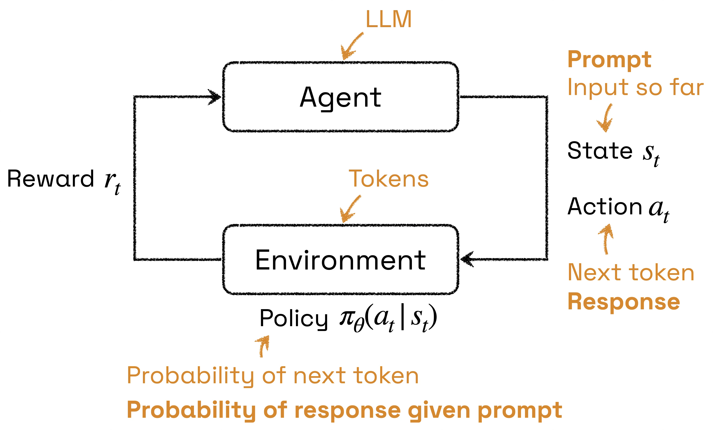
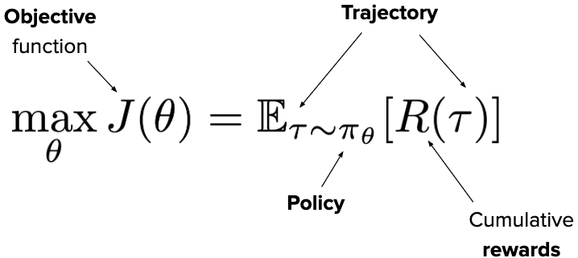
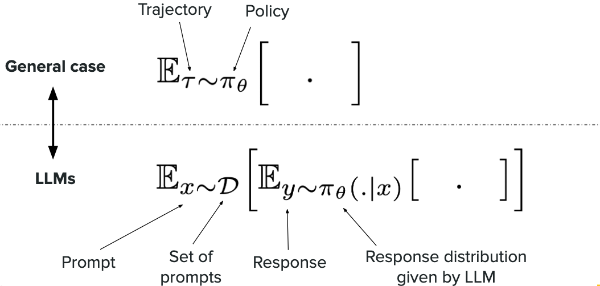
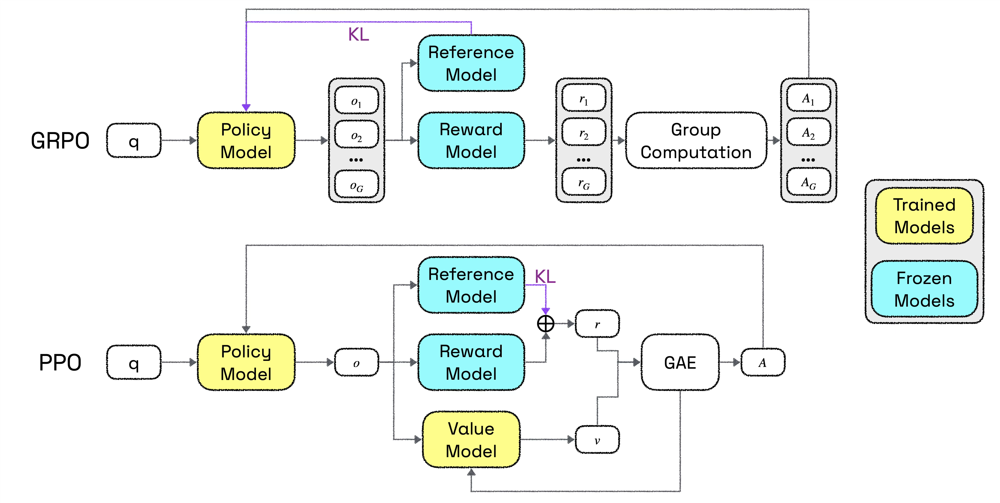
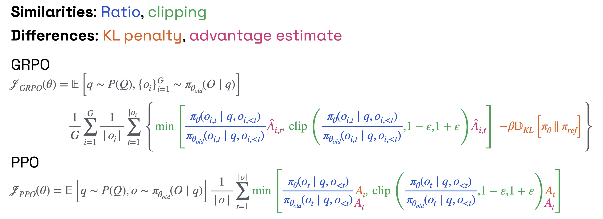
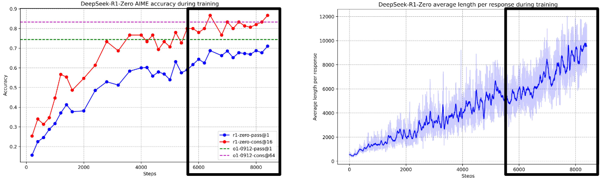

> [!NOTE] Stanford CME 295 筆記系列
> 1. [從 Attention 重新認識 Transformer](/posts/cme295-lecture-1-transformers/)
> 2. [LLM 的架構選擇，從 BERT、GPT 到 MoE 與 RoPE](/posts/cme295-lecture-2-large-language-models/)
> 3. [LLM 怎麼訓練，從 Pre-training 到 RLHF、GRPO](/posts/cme295-lecture-3-llm-training/)
> 4. **用 RL 訓練 LLM，從 REINFORCE、PPO 到 GRPO (本篇)**
>
> 文中示意圖皆取自或重繪自 [Stanford CME 295 課程簡報](https://cme295.stanford.edu/syllabus/)，版權歸原課程所有。

## 用 RL 的框架看 LLM 生成

RL 讓 agent 在環境中反覆採取行動、根據得到的 reward 調整策略，套用到 LLM 時，生成文字的過程本身就可以看成一連串這樣的決策：

- Agent (做決策的主體) $\Rightarrow$ LLM 本身。
- Environment (agent 互動的對象，接收行動後轉移到新狀態) $\Rightarrow$ 目前的 token 序列：每生成一個 token，它就被接到序列後面，形成新的狀態。
- State $s_t$ (agent 當下觀察到的情況) $\Rightarrow$ token 層級是「到目前為止的輸入」，即 prompt 加上已生成的 token；回應層級則是 prompt。
- Action $a_t$ (agent 在該狀態下做出的選擇) $\Rightarrow$ token 層級是下一個 token；回應層級則是整段 response。
- Policy $\pi_\theta(a_t \mid s_t)$ (在某狀態下選擇各行動的機率分布) $\Rightarrow$ token 層級是下一個 token 的機率，也就是 LLM 的輸出分布；回應層級則是 prompt 條件下產生整段 response 的機率。
- Reward $r_t$ (環境對行動給出的回饋) $\Rightarrow$ 通常只在整段 response 結束後才給一次分數，來源可以是 reward model 或依 ground truth 驗證；中間每個 token 幾乎沒有獎勵 (若有，多半只是 KL penalty)。

## Reward 的兩種類型

Reward 有兩類型：

- 主觀 (Subjective)：例如人類的偏好，通常以 Bradley-Terry 訓練 reward model 來近似，preference tuning 中的 RL from Human Feedback (RLHF) 即為此類。
- 可驗證 (Verifiable)：例如有 ground truth 的數學或程式問題，可直接用規則判斷對錯，推理訓練多屬此類，稱為 RL with Verifiable Rewards (RLVR)。

## Policy gradient 與 log-derivative trick

RL 的目標是找出一組模型參數 $\theta$，使得從 policy $\pi_\theta$ 取樣出的 trajectory，平均能拿到最高的累積 reward：

其中 trajectory $\tau$ 是 agent 與環境互動產生的一整串「狀態、行動」序列，在 LLM 中，就是從 prompt 開始、一個 token 接一個 token 生成出完整回應的過程，$R(\tau)$ 則是這段回應最終得到的 reward。
和其他機器學習問題一樣，我們希望用梯度上升來最佳化這個目標，因此需要求出 $\nabla_\theta J(\theta)$。
但是，因為 $\theta$ 出現在期望值的下標 $\tau \sim \pi_\theta$ (決定會抽到哪些 trajectory) 中，如果在算梯度時先取樣幾段 trajectory、算出平均 reward $\frac{1}{N}\sum_i R(\tau_i)$ 再對它微分，因為 $R(\tau_i)$ 與 $\theta$ 無關，所以結果會是零，也就是說，$\theta$ 的影響藏在取樣這一步，樣本一旦抽出、固定下來，這個影響就消失了。
為了把 $\theta$ 的影響找回來，我們把期望值寫成積分，讓梯度直接作用在機率上：

$$
\nabla_\theta J(\theta) = \nabla_\theta \int \pi_\theta(\tau)\, R(\tau)\, d\tau = \int \nabla_\theta \pi_\theta(\tau)\, R(\tau)\, d\tau
$$

然而這個積分無法用取樣估計：取樣只能估計「某個機率分布下的期望值」，而 $\nabla_\theta \pi_\theta(\tau)$ 可能為負、加總也不等於 1，不是可以抽樣的分布，直接計算就得窮舉所有可能的 trajectory，也不可行，換句話說，雖然 $J(\theta)$ 本身是期望值，但梯度移進積分之後，$\nabla_\theta J(\theta)$ 就不再是了。
所以下一步是想辦法讓梯度也變回期望值的形式，這時必須使用名為 log-derivative trick 的小技巧，利用 $\nabla_\theta \log \pi_\theta = \frac{\nabla_\theta \pi_\theta}{\pi_\theta}$，即 $\nabla_\theta \pi_\theta = \pi_\theta \nabla_\theta \log \pi_\theta$ 在積分中重新湊出 $\pi_\theta(\tau)$ 這個機率分布：

$$
\nabla_\theta J(\theta) = \int \pi_\theta(\tau)\, \nabla_\theta \log \pi_\theta(\tau)\, R(\tau)\, d\tau = \mathbb{E}_{\tau \sim \pi_\theta}\big[R(\tau)\, \nabla_\theta \log \pi_\theta(\tau)\big]
$$

以上即為 policy gradient theorem。
如此一來，梯度也能用取樣來估計了，而且這時取樣只是估計期望值的手段：抽出來的 trajectory 被當成固定的資料，梯度透過 $\nabla_\theta \log \pi_\theta(\tau)$，也就是「這段固定 trajectory 的 log 機率」傳回模型，而不是穿過取樣這個動作，原本藏在取樣裡、樣本固定後就消失的 $\theta$ 的影響，現在被顯式地寫進了這一項。
有了一般形式之後，接著把它對應到 LLM 上：

圖中的「·」有兩種用法：期望值括號中的 $[\,\cdot\,]$ 是佔位符號，代表「任何要取平均的量」，例如 $R(x, y)$ 或 $R(x, y)\, \nabla_\theta \log \pi_\theta(y \mid x)$，圖上刻意留白，是為了強調不管裡面放什麼，取平均的方式都一樣；而 $\pi_\theta(\cdot \mid x)$ 中的「·」則代表「尚未指定的 response」，也就是說，$\pi_\theta(\cdot \mid x)$ 指的不是某一段特定 response 的機率，而是給定 prompt $x$ 之後，模型對所有可能 response 的整個機率分布，$y \sim \pi_\theta(\cdot \mid x)$ 就是從這個分布中抽出一段 response。
一般情況下，trajectory $\tau$ 整段都由 policy 產生，但在 LLM 中，trajectory 由兩部分組成：prompt $x$ 從 prompt 資料集 $\mathcal{D}$ 中抽出，和模型無關；只有 response $y$ 是由 LLM 依 $\pi_\theta(\cdot \mid x)$ 生成的，因此期望值也得拆成兩層，外層對 prompt 取平均，內層對模型生成的 response 取平均，又因為 $\theta$ 只影響內層，套用相同的 log-derivative trick 即得：

$$
\nabla_\theta J(\theta) = \mathbb{E}_{x \sim \mathcal{D}}\Big[\mathbb{E}_{y \sim \pi_\theta(\cdot \mid x)}\big[R(x, y)\, \nabla_\theta \log \pi_\theta(y \mid x)\big]\Big]
$$

其中 $\log \pi_\theta(y \mid x)$ 可以用 chain rule 拆成 response 中每個 token 的 log 機率加總 $\sum_t \log \pi_\theta(y_t \mid x, y_{<t})$，和 SFT 計算的是同一個量。
因此 policy gradient 可以理解成以 reward 加權的 SFT：SFT 是提高示範回應的 log 機率；policy gradient 則是提高模型自己生成、且 reward 高的回應的 log 機率，reward 越高推得越用力，reward 為負時則反過來壓低機率。

## REINFORCE：用取樣估計梯度

剩下的問題是，這個梯度仍是期望值，無法窮舉所有 prompt 與 response 直接計算，所以最後要把它變成實際可執行的演算法。
這時就得引入 Monte Carlo 的精神，既然算不出期望值，就實際取樣，用樣本的平均來估計它，取樣越多估得越準。
[REINFORCE](https://link.springer.com/article/10.1007/BF00992696) (Williams, 1992) 就是這樣做的：

1. 給定一個 prompt $x$，讓模型生成一段 response $y \sim \pi_\theta(\cdot \mid x)$。
2. 等 response 生成完畢，再計算 reward $R = R(x, y)$。
3. 計算 $g = R\, \nabla_\theta \log \pi_\theta(y \mid x)$，這就是梯度的一個取樣估計。
4. 以 $\theta \leftarrow \theta + \alpha g$ 更新參數，其中 $\alpha$ 是 learning rate；這裡是梯度上升，因為目標是最大化 reward。

這個做法在 RL 中被稱為 Monte Carlo 演算法，除了用取樣平均估計期望值之外，還有另一層意思：它必須等整段 trajectory 結束、拿到實際的完整 reward 才更新，也就是 step 2 的「等 response 生成完畢」，而不是在中途用另一個模型去預測未來能拿多少分 (後者正是 PPO 中 value model 所做的事)。
其中最昂貴的是 step 1，因為 LLM 生成 response 是 auto-regressive 的，必須一個 token 接一個 token 依序產生，無法像訓練時那樣平行計算，response 越長越慢，而推理任務的 response 往往特別長，更麻煩的是，policy gradient 要求樣本來自目前的模型 $\pi_\theta$，參數一更新，舊的樣本就不再符合目前的分布，必須重新生成，因此 RL 訓練的時間有很大一部分都花在生成上，而不是更新參數。

### 用 importance sampling 重複利用樣本

為了讓每一批昂貴的樣本能被多用幾次，可以改從一個固定不動的模型 $\pi_{\theta_{\text{fix}}}$ 取樣，在同一批樣本上連續更新 $\theta$ 好幾次，再用 importance sampling 修正兩個分布之間的落差：

$$
\mathbb{E}_{\tau \sim \pi_\theta}\big[f(\tau)\big] = \int \pi_{\theta_{\text{fix}}}(\tau)\, \frac{\pi_\theta(\tau)}{\pi_{\theta_{\text{fix}}}(\tau)}\, f(\tau)\, d\tau = \mathbb{E}_{\tau \sim \pi_{\theta_{\text{fix}}}}\left[\frac{\pi_\theta(\tau)}{\pi_{\theta_{\text{fix}}}(\tau)}\, f(\tau)\right]
$$

中間那步只是乘上再除以 $\pi_{\theta_{\text{fix}}}$，所以兩邊完全等價，其中 $\frac{\pi_\theta}{\pi_{\theta_{\text{fix}}}}$ 稱為 importance sampling ratio。
直覺上的意義是，某段 trajectory 在新模型下比在舊模型下更可能出現，就應該被算得更重，反之則更輕。
注意，這裡並不會重新生成 response，$\pi_{\theta_{\text{fix}}}$ 生成的 response 內容固定不變，生成時記錄下的機率即為 ratio 的分母；每次更新時，只需把同一段 response 丟進目前的 $\pi_\theta$ 做一次 forward pass，就能像 SFT 一樣平行算出它在新模型下的機率，作為 ratio 的分子。昂貴的生成只做一次，之後的每次更新都只是便宜的評分。

### REINFORCE 的訓練挑戰

解決了生成成本之後，REINFORCE 在訓練上仍有三個挑戰：

- 梯度的 variance 很高 (high variance gradients)：這個估計雖然在期望上是正確的，但每次只取樣少數幾段回應，估出的梯度波動很大，訓練不穩定。
  最直覺的緩解方式是一次取樣一批 prompt 與 response，把各自的 $g$ 取平均後再更新，但這只能部分降低波動，更根本的問題在於 reward 的絕對值，例如當所有回應的 reward 都是正的時，每段回應都會被提高機率，只是幅度不同，模型很難分辨哪些回應真正比較好。
  因此更常見的解法是把 $R$ 換成 $R - b$，減去一個 baseline $b$ (例如預期的平均 reward) 就能大幅降低 variance，只有比預期好的回應會被提高機率，比預期差的則被壓低。
  注意，這麼做並不會改變梯度的期望值。由於 $b$ 與 $y$ 無關，可以直接提到期望值外面：

  $$
  \mathbb{E}_{y \sim \pi_\theta}\big[(R - b)\, \nabla_\theta \log \pi_\theta(y \mid x)\big] = \mathbb{E}_{y \sim \pi_\theta}\big[R\, \nabla_\theta \log \pi_\theta(y \mid x)\big] - b\, \mathbb{E}_{y \sim \pi_\theta}\big[\nabla_\theta \log \pi_\theta(y \mid x)\big]
  $$

  多出來的只有後面那一項，而其中的期望值恆為 0，只要反過來使用 log-derivative trick 即可證明：

  $$
  \mathbb{E}_{y \sim \pi_\theta}\big[\nabla_\theta \log \pi_\theta(y \mid x)\big] = \sum_y \pi_\theta(y \mid x)\, \nabla_\theta \log \pi_\theta(y \mid x) = \sum_y \nabla_\theta \pi_\theta(y \mid x) = \nabla_\theta \sum_y \pi_\theta(y \mid x) = \nabla_\theta 1 = 0
  $$

  因此不論 $b$ 是多少，梯度的期望值都不變，直覺上，所有 response 的機率加總永遠是 1，提高某些 response 的機率必然壓低其他的，平均起來的推力剛好互相抵銷，所以對每段 response 都減去同樣的 $b$，不會改變整體的方向，只會改變每個樣本各自被推的幅度與正負。
  而這裡的 $R - b$ 就是第三堂提到的 advantage：PPO 用 value model 估計 $b$，GRPO 則直接用同一題多個回答的平均 reward 當作 $b$。 
- 缺少明確的 token-level credit (no explicit token-level credit)：整段 response 只有一個 reward $R$，而 $\nabla_\theta \log \pi_\theta(y \mid x) = \sum_t \nabla_\theta \log \pi_\theta(y_t \mid x, y_{<t})$ 中的每個 token 都乘上同一個 $R$，也就是說，一段答對的推理中，關鍵的那一步和無關緊要的贅字被同等地強化，一段答錯的推理中，前面正確的步驟也會和最後出錯的那一步一起被壓低。
  模型無法從中得知「到底是哪個 token 做對或做錯」，學習效率因此很低，PPO 的 value model 就是為了處理這件事，它在每個位置預估「從這裡開始預期能拿多少分」，讓每個 token 有各自的 advantage；相較之下，GRPO 把同一個 advantage 分給回應中的所有 token，在這一點上仍然相當粗略。 
- Policy 更新的幅度沒有限制 (no constraint on magnitude of policy updates)：vanilla REINFORCE 只管往 reward 高的方向走，不限制模型能改變多少，但我們其實不希望模型離起點太遠。一是起點的 SFT 模型已經相當不錯，RL 要做的是微調而非推倒重來；二是大幅改動參數，可能讓模型在既有的任務上退步；三是離起點越遠，越容易出現 reward hacking，也就是鑽 reward model 的漏洞，產生分數很高、實際上卻很糟的回應。前面引入的 importance sampling 也會加劇這個問題，$\pi_\theta$ 離 $\pi_{\theta_{\text{fix}}}$ 越遠，ratio 就越極端。
  因此需要限制 $\pi_\theta$ 不要離參考的模型太遠，這引出了一個問題：要怎麼量化兩個分布之間的差距？答案正是第三堂提過的 KL divergence，這也是之後 PPO 與 GRPO 加入 KL penalty、並以 clipping 限制更新幅度的由來。

## PPO (Proximal Policy Optimization)

前面 REINFORCE 以整段 response 的 reward 來加權梯度，衡量的是「這段回應有多好」；PPO 則改成兩件事：「最大化 advantage」，衡量的是「這一步跟預期相比有多好」，對應前面的第二個挑戰，以及「別離原本的模型太遠」，對應第三個挑戰 (名稱中的 Proximal 指的就是這一點)。

### 優勢函數 (advantage) 與 value function

這裡可以用一個簡單的例子來理解，prompt 是「Teddy is in a box. Where is Teddy?」，模型正在逐字生成回答「In the box.」。
假設我們能在每個位置估計「照目前的開頭寫下去，最後能拿到多少 reward」：寫完「In」時大約是 0.6，寫完「In the」時是 0.7，寫完「In the box」時跳到 0.95。
從 0.7 到 0.95 的這一跳，代表「box」這個 token 讓結果變得明顯更好，它的貢獻就是 $0.95 - 0.70 = +0.25$，如此一來，即使整段回應只有最後一個 reward，每個 token 也能各自得到功過評價。
這個「照目前的開頭寫下去，預期最後能拿到多少 reward」就是 value function：

$$
V^\pi(x, y_{<t}) = \mathbb{E}_\pi\big[R_{\text{future}} \mid x, y_{<t}\big]
$$

其中 $x$ 是 prompt，$y_{<t}$ 是目前已生成的部分 response，上標 $\pi$ 則表示這個預期值是針對某個特定的 policy 而言，因為「照目前的開頭寫下去」會寫出什麼，取決於模型本身。
實務上，value function 由另一個 value model 來估計，它和 reward model 一樣，是在 LLM 上接一個輸出純量的 regression head，但它在每個 token 位置都輸出一個預測值，訓練的 label 則是整段 response 最終拿到的 reward，也因為它依賴於 policy，value model 必須和 policy 一起訓練，policy 一更新，預期值就得跟著調整。
有了 value function，前面例子裡「這一跳」就能寫成 advantage，把 $(x, y_{<t})$ 看成 state、$y_t$ 看成 action，比較選了 $y_t$ 之後與之前的 value，差值就是這個選擇帶來的改變：

$$
A^\pi(x, y_{<t}, y_t) = V^\pi(x, y_{\leq t}) - V^\pi(x, y_{<t})
$$

$A_t > 0$ 代表這個 token 比預期好，應該提高它的機率，$A_t < 0$ 則應該壓低。
這也可以看成是 REINFORCE baseline 的延伸，$V^\pi(x, y_{<t})$ 就是一個隨位置變化的 baseline，不只降低了 variance，也讓每個 token 有了各自的 credit (實際上 PPO 計算 advantage 的方式更複雜，會用 GAE 把多步的差值加權平均，以平衡估計的 bias 與 variance，這裡只取其直覺)。
因此目標函數從最大化 reward 的期望值，變成最大化 advantage 的期望值：

$$
\mathbb{E}_t\big[R_t\big] \;\longrightarrow\; \mathbb{E}_t\big[A_t\big]
$$

不過實際訓練時，正如前面 REINFORCE 所提到的，為了節省昂貴的生成成本，PPO 會用 $\pi_{\text{old}}$ (也就是前面的 $\pi_{\theta_{\text{fix}}}$) 生成一批樣本，再在同一批樣本上對 $\pi_\theta$ 連續更新好幾次，所以要用 importance sampling ratio 修正兩者的落差：

$$
\mathbb{E}_t\left[\frac{\pi_\theta(a_t \mid s_t)}{\pi_{\text{old}}(a_t \mid s_t)}\, A_t\right] = \mathbb{E}_t\big[\rho_t(\theta)\, A_t\big]
$$

其中 $\rho_t(\theta)$ 是 current policy 與 old policy 在第 $t$ 個 token 上的機率比值。
注意這裡和前面以整段 trajectory 計算的 ratio 不同，這裡是逐 token 計算 (advantage 本身就是 token-level 的)。

> [!NOTE] 延伸閱讀：[GAE](https://arxiv.org/abs/1506.02438) (Generalized Advantage Estimation, Schulman et al., 2015) 
> 上面說 Advantage 是「選了 $y_t$ 前後 value 相減」的寫法是簡化過的直覺，實際上 PPO 用的是 GAE。
> 這是因為，只看一步的差值，結果完全依賴 value model 的預測，value model 估不準時 advantage 就會有偏差 (bias)，反過來，若多看幾步、更多地使用實際拿到的 reward，偏差會變小，但估計的波動 (variance) 又會變大，而 GAE 用一個參數 $\lambda$ 在兩者之間取捨，把不同步數的估計加權平均起來。

### 別離參考模型太遠：clipping 與 KL penalty

至於第二件事「別離原本的模型太遠」，有兩種常見的做法。
第一種是 clipping，把 ratio 限制在 $[1-\epsilon, 1+\epsilon]$ 之內：

$$
J(\theta) = \mathbb{E}_t\Big[\min\big(\rho_t(\theta) A_t,\ \text{clip}(\rho_t(\theta), 1-\epsilon, 1+\epsilon)\, A_t\big)\Big]
$$

當 $A_t > 0$ 時，提高這個 token 機率所帶來的好處，最多只算到 ratio 為 $1+\epsilon$ 為止；當 $A_t < 0$ 時，壓低機率的好處最多也只算到 $1-\epsilon$，超出範圍就不再提供更新的動力，取 $\min$ 則確保永遠採用比較保守的那一個，等於限制每一步只能走一小步。
第二種是直接在目標函數中加上 KL penalty：

$$
J(\theta) = \mathbb{E}_t\Big[\rho_t(\theta) A_t - \beta\, \text{KL}\big(\pi_\theta(\cdot \mid s_t) \,\|\, \pi_{\text{ref}}(\cdot \mid s_t)\big)\Big]
$$

用 KL divergence 量化目前的 policy 與 reference model (通常是 SFT 後的模型) 的差距，$\beta$ 越大，限制越嚴格。
注意，以上兩者限制的對象不同，clipping 比較的是 $\pi_{\text{old}}$，限制的是「每一步」能走多遠；KL penalty 比較的是固定不變的 $\pi_{\text{ref}}$，限制的是「總共」能偏離多遠，實務上常同時使用。
這個 KL penalty 也正是和 DPO 的連結：DPO 就是從同一個「最大化 reward、同時以 $\beta$ 加權的 KL 限制不偏離 $\pi_{\text{ref}}$」的目標函數推導出來的，所以 DPO loss 中的 $\beta \log \frac{\pi_\theta(y \mid x)}{\pi_{\text{ref}}(y \mid x)}$，用的是同一個 $\beta$ 與同一個 $\pi_{\text{ref}}$，差別在於 PPO 以 reward model 與 value model 計算 advantage、再一步步最佳化，DPO 則把 reward 直接寫成 policy 本身的 implicit reward，跳過了 RL。

### 三個不同的 policy

注意這堂課出現了三個不同的 policy：$\pi_\theta$ 是正在訓練、每一步都在更新的模型；$\pi_{\text{old}}$ 是這一輪用來生成樣本的模型，每輪結束後更新成目前的 $\pi_\theta$；$\pi_{\text{ref}}$ 則是 SFT 後的模型，在整個訓練過程中固定不變。

## GRPO：以同組 response 取代 value model

PPO 需要額外訓練一個和 policy 差不多大的 value model 來提供 baseline，既費工又佔記憶體，而且在只有最終答案才有 reward 的推理任務上，value model 本身也很難估得準，因此 GRPO 取消了 value model，改用另一種方式取得 baseline：對同一個 prompt $x$ 生成一組 $G$ 個 response $o_1, \dots, o_G$，以這組 response 的平均 reward 作為 baseline，再除以標準差把尺度標準化，得到每個 response 的 advantage：

$$
\hat{A}_i=\frac{R(x,o_i)-\text{mean}(\{R(x,o_1), \dots, R(x,o_G)\})}{\text{std}(\{R(x,o_1), \dots, R(x,o_G)\})}
$$

比同組平均好的 response，advantage 為正；比平均差的則為負，這就是名稱中 Group Relative 的意思。

### GRPO 與 PPO 的架構比較

除此之外，GRPO 的目標函數和 PPO 一樣包含 clipping 與 KL penalty，下圖比較了兩者的架構，黃色是訓練中的模型，藍色是凍結的模型：

其中最明顯的差別在於要訓練的模型數量，PPO 要同時訓練 policy model 與 value model (從 GAE 連回 value model 的那條線，就是用實際拿到的報酬作為 value model 的訓練目標)；GRPO 則省去了 value model，只需要訓練 policy model。
另外，圖中的 reward model 並非必要，在數學、程式這類有 ground truth 可以比對的任務中，可以直接用規則判斷答案是否正確作為 reward (verifiable rewards)，此時 GRPO 只需要 policy model 與 reference model。
從兩個架構的目標函數可以更清楚看出兩者的異同：

先統一一下符號，上圖中 $q$ 是 prompt，$o$ 是模型生成的 response，對應前面 policy gradient 中的 $x$ 與 $y$；$q \sim P(Q)$ 則對應從 prompt 資料集取樣。
兩者相同的部分是 importance sampling ratio $\frac{\pi_\theta}{\pi_{\theta_{old}}}$ 與 clipping，也就是前面 PPO 用來「重複使用同一批樣本」與「限制每一步走多遠」的機制，GRPO 完整保留了下來，而且兩者都是逐 token 計算 ratio。
而不同的部分有兩個：

- 第一個是 KL penalty 的位置，GRPO 把它寫成目標函數中顯式的一項 $-\beta \mathbb{D}_{KL}[\pi_\theta \,\|\, \pi_{ref}]$；PPO 的目標函數裡則看不到 KL，因為它被併進了 reward：每個 token 位置都會扣掉該 token 的 KL 懲罰，reward model 的分數則加在最後一個 token 上，合起來再交給 GAE 計算 advantage。PPO 這樣做，是把「不要偏離 $\pi_{ref}$」視為環境給的 reward 的一部分，如此就能沿用標準的 RL 演算法而不必修改目標函數，而且逐 token 的 KL 懲罰也讓原本只有最後一步才有的 reward 變得比較密集，value model 和 GAE 都能利用。GRPO 則不能這樣做，因為它的 advantage 是在組內對整段 response 的 reward 做標準化，若把逐 token 的 KL 混進 reward，會干擾組內比較的意義，所以直接把 KL 項放在 loss 上，讓 advantage 的計算保持單純。
- 第二個是 advantage 的估計方式，從下標就能看出來：GRPO 的 $\hat{A}_{i,t}$ 有兩個下標，$i$ 表示這是同一個 prompt 生成的 $G$ 個 response 中的第幾個，屬於 completion level，$t$ 表示該 response 中的第幾個 token，屬於 token level；而 PPO 每次只取樣一個 response，所以 $A_t$ 只有 token level 的下標。不過在只有最終 reward 的情況下，GRPO 的 $\hat{A}_{i,t}$ 其實和 $t$ 無關，同一個 response 中的每個 token 都共用組內標準化後的同一個 $\hat{A}_i$，下標 $t$ 只是形式上的；PPO 的 $A_t$ 則由 value model 經 GAE 算出，每個 token 各不相同。
  這就是 GRPO 用省掉 value model 換來效率的代價，它放棄了 token-level 的 credit assignment，也因為多了 $i$ 這一層，GRPO 的目標函數多了外層的 $\frac{1}{G}\sum_{i=1}^{G}$，先在每個 response 內對 token 取平均，再對整組 response 取平均。

### 長度偏差：DAPO 與 Dr. GRPO

在 GRPO 的目標函數中，$\frac{1}{|o_i|}$ 是對第 $i$ 個 response 的 token 數取平均，用意是讓長短不同的 response 在加總時有相同的權重，但它也帶來了長度偏差：同一個 response 中，每個 token 分到的梯度權重是 $\frac{\hat{A}_i}{|o_i|}$，也就是說，response 越長，每個 token 被推動的力道就越小。
當 $\hat{A}_i > 0$ 時，短的正確答案每個 token 被強化得更多，模型傾向寫出更短的正確答案；當 $\hat{A}_i < 0$ 時，長的錯誤答案每個 token 被懲罰得更少，所以同樣是答錯，寫得越長受到的懲罰越輕，模型因此傾向把錯誤答案拉長，這點從下圖可以看出來 (RL 訓練中 response 長度持續增加，雖然有一部分來自更長的推理確實有助於答對，但其中也混雜了這個偏差造成的、錯誤答案的不必要拉長)：

針對這個問題，後續有兩種修改 $\frac{1}{|o_i|}$ 這一項的做法： 

- [DAPO](https://arxiv.org/abs/2503.14476)：改為 token-level 的平均，把整組 response 的所有 token 合在一起，除以總 token 數 $\sum_{i=1}^{G}|o_i|$，讓每個 token 的權重相同，不再依所屬 response 的長度而異。

  $$
  \frac{1}{\sum_{i=1}^{G}|o_i|}\sum_{i=1}^{G}\sum_{t=1}^{|o_i|}
  $$

  另外，DAPO 也修改了 clipping 的範圍，把原本對稱的 $[1-\epsilon, 1+\epsilon]$ 拆成上下界各自獨立的 $[1-\epsilon_{\text{low}}, 1+\epsilon_{\text{high}}]$，並讓 $\epsilon_{\text{high}}$ 大於 $\epsilon_{\text{low}}$ (稱為 Clip-Higher)，目的是鼓勵多樣性。
  原因在於 clipping 限制的是機率的「比例」：以常用的 $\epsilon = 0.2$ 為例，新機率最多只能是舊機率的 1.2 倍，一個機率為 0.9 的 token，$0.9 \times 1.2$ 已超過 1，實際上可以被推到接近 1；但一個機率只有 0.01 的 token，每一輪最多只能提高到約 $0.01 \times 1.2 = 0.012$，幾乎動不了。
  這些低機率的 token 往往正是模型嘗試新解法的地方，它們成長不起來，模型就會越來越集中在原本就高機率的少數寫法上，同一組 response 變得千篇一律，GRPO 的組內比較也因此失去意義 (全部答案相同時，advantage 全為 0)。
  調高上界讓低機率但表現好的 token 有更多成長空間，下界維持不變，則避免模型把其他 token 的機率壓得太快、太低。
- [Dr. GRPO](https://arxiv.org/abs/2503.20783)：直接拿掉 $\frac{1}{|o_i|}$，改除以一個固定的常數 (例如最大生成長度)；同時也拿掉 advantage 中除以標準差的那一步，因為它同樣會帶來偏差，讓 reward 標準差小的題目 (太簡單或太難的題) 被過度加權，這個問題在論文中被稱為 bias linked to level of difficulty。

  $$
  \frac{1}{G}\sum_{i=1}^{G}\sum_{t=1}^{|o_i|}, \qquad \hat{A}_i = R(x, o_i) - \text{mean}(\{R(x,o_1), \dots, R(x,o_G)\})
  $$

## On-policy distillation

### GRPO 仍未解決的 token-level credit

回顧前面 REINFORCE 時提到的三個挑戰，GRPO 解決了其中兩個：梯度的 variance 很高 (以同組 response 的平均 reward 作為 baseline，並除以標準差做標準化)，以及 policy 更新的幅度沒有限制 (沿用 PPO 的 clipping，並加上 KL penalty)。但剩下的 no explicit token-level credit assignment 仍未解決，由於 advantage 是對整段 response 計算的，同一段 response 中的每個 token 都拿到相同的 advantage，這帶來兩個後果：

- 短期來看，訊號很雜 (noisy)：一段最終答錯的推理中，前面正確的步驟也會被一起壓低；一段答對的推理中，多餘甚至錯誤的步驟也會被一起強化。
- 長期來看，學習很慢 (slow)：好的步驟之所以能被學到，只是因為它們「平均而言」比較常出現在答對的 response 裡，必須累積很多組樣本，這個統計上的差異才會浮現。

### 以 teacher 逐 token 給分

而把前面討論過各種方法的優缺點放在一起，我們真正想要的其實是三件事：一是 on-policy training，在模型自己生成的 response 上學習，才能學會如何從自己的錯誤中恢復，避免 SFT 的 exposure bias；二是每個 token 都有明確的 credit assignment，而不是整段共用一個分數；三是不需要額外訓練任何模型，像 PPO 的 value model 或 reward model 那樣。
這三個願望對應的做法是：讓模型自己生成 response，在每個 token 位置都計算類似 next token prediction 的 loss，而提供這個逐 token 訊號的，是一個現成、更強的 teacher 模型，這就是 on-policy distillation。
具體來說，student 模型 $\pi_\theta$ 先自己生成 response $y \sim \pi_\theta(\cdot \mid x)$，再由 teacher $\pi_T$ 對同一段 response 做一次 forward pass，在每個位置比較兩者對下一個 token 的機率分布，以 reverse KL 作為 loss：

$$
\mathcal{L}(\theta) = \mathbb{E}_{x \sim \mathcal{D},\, y \sim \pi_\theta(\cdot \mid x)}\left[\sum_t D_{KL}\big(\pi_\theta(\cdot \mid x, y_{<t}) \,\|\, \pi_T(\cdot \mid x, y_{<t})\big)\right]
$$

這裡之所以用 reverse KL $D_{KL}(\pi_\theta \,\|\, \pi_T)$ 而不是 forward KL $D_{KL}(\pi_T \,\|\, \pi_\theta)$，原因有二：

- 第一，依照第三堂 $D_{KL}(P \,\|\, Q)$ 的直覺，事件按照 $P$ 發生、我們以 $Q$ 的信念去衡量驚訝程度。在 reverse KL 中，「實際發生的世界」是 student 的分布，也就是 response 由 student 自己生成，再由 teacher 評估，這正是 on-policy；forward KL 則反過來，response 要由 teacher 生成，等於回到了模仿 teacher 示範的 off-policy distillation。
- 第二，reverse KL 是 mode-seeking 的 (這裡的 mode 是眾數，即機率分布中的峰值，mode-seeking 即 student 傾向集中在 teacher 的少數幾個峰上，而非試圖覆蓋所有可能)。
  把第三堂 KL divergence 的定義套到某個位置的下一個 token 上，記 student 與 teacher 給第 $i$ 個 token 的機率為 $s_i$ 與 $t_i$：

  $$
  \text{KL}(S ,|, T) = \sum_i s_i \log\left(\frac{s_i}{t_i}\right)
  $$

  若某個 token teacher 認為幾乎不可能 ($t_i \to 0$)，student 卻給了機率 ($s_i > 0$)，$\log \frac{s_i}{t_i}$ 會趨近無限大，懲罰極重；反過來，若 teacher 認為可行的 token，student 不給機率 ($s_i \to 0$)，該項前面乘上 $s_i$，幾乎沒有懲罰。
  因此 student 會專注在 teacher 最有把握的幾種寫法上，而不是試圖覆蓋 teacher 所有可能的寫法，這對容量較小的 student 來說更容易學好。

實際計算時，每個位置的 reverse KL 可以用 student 實際取樣到的 token 來估計，即 $\log \pi_\theta(y_t \mid x, y_{<t}) - \log \pi_T(y_t \mid x, y_{<t})$，student 比 teacher 更有信心的 token 會被懲罰，teacher 認為好、student 卻不夠有信心的 token 則會被鼓勵。
換句話說，它就像一個逐 token 給分的 reward，同時滿足了 on-policy、逐 token credit，以及不需額外訓練這三個願望，而每個 response 提供的資訊量也從 RL 的約 1 bit，提升到與 token 數成正比。

### 優點與限制

在實務上，on-policy distillation 有三個明顯的優點：

* 效果好：[Qwen3 的技術報告](https://arxiv.org/abs/2505.09388) 指出，用 on-policy distillation 訓練的模型在 AIME'24 上達到 74.4%，高於以 RL 訓練的 67.6%。
* 計算效率高：同樣的實驗中，它只用了約 1,800 GPU 小時，而 RL 用了 17,920 GPU 小時，大約只有十分之一 ([On-Policy Distillation](https://thinkingmachines.ai/blog/on-policy-distillation/), Thinking Machines Lab, 2025)，原因正是每個 token 都提供訊號，學習速度遠快於只靠最終 reward 的 RL。
* 不需要 reward model：teacher 本身就扮演了逐 token 給分的角色，不需要另外訓練 reward model，也不需要像 RLVR 那樣依賴可驗證的 ground truth，因此也能用在沒有標準答案的任務上。

不過 on-policy distillation 也有其限制。首先，它需要一個現成、更強的 teacher，而 student 的能力上限大致就是 teacher 的水準，它擅長的是把已有的能力轉移到較小或較便宜的模型上，而不是發現新能力，後者仍然得靠 RL。其次，由於要逐 token 比較機率分布，teacher 與 student 必須共用同一個 tokenizer，否則同一個位置的 token 根本對不上。再者，訓練時每段 response 都要經過 teacher 做一次 forward pass，teacher 越大，這部分的成本越高。最後，student 的生成若和 teacher 的推理方式差距太大，teacher 在那些它自己不會走到的狀態上給出的評分也不可靠，因此通常需要先用少量 SFT 讓 student 的分布接近 teacher，再進行 on-policy distillation。
另外還有兩種延伸也可以放在這個框架下理解：

- Self-distillation 是把 teacher 換成模型自己，此時不再受限於「需要一個更強的外部 teacher」，常見的有兩種形式。一是使用較早版本的 checkpoint 當 teacher：當模型在 mid-training 或 fine-tuning 中學了新知識、卻遺忘了原本的能力 (例如遵循指令) 時，可以用舊版本的自己把這些能力找回來 ([On-Policy Distillation](https://thinkingmachines.ai/blog/on-policy-distillation/))。二是讓同一個模型當 teacher，但給它一個提示 ([OPSD](https://arxiv.org/abs/2601.18734))：teacher 的 context 中額外放入題目的正確答案或參考解法，student 則只看得到題目，兩者共用同一組參數，訓練時讓 student 自己生成 response，再由「看過答案的自己」逐 token 評分。這就像學生做錯題後對照詳解重新檢討，模型學會的是在沒有提示的情況下，也寫出有提示時才寫得出的推理。
- Multi-teacher on-policy distillation 則是同時使用多位 teacher ([MOPD](https://arxiv.org/abs/2606.30406))：先針對不同領域各自訓練出專家，再讓 student 的每個 prompt 依領域交給對應的 teacher 評分，把多位專家的能力整合進同一個模型。
