> [!NOTE] Stanford CME 295 筆記系列
> 1. [從 Attention 重新認識 Transformer](/posts/cme295-lecture-1-transformers/)
> 2. [LLM 的架構選擇，從 BERT、GPT 到 MoE 與 RoPE](/posts/cme295-lecture-2-large-language-models/)
> 3. [LLM 怎麼訓練，從 Pre-training 到 RLHF、GRPO](/posts/cme295-lecture-3-llm-training/)
> 4. [用 RL 訓練 LLM，從 REINFORCE、PPO 到 GRPO](/posts/cme295-lecture-4-rl-with-llms/)
> 5. **LLM Systems，從 FlashAttention 到 MTP (本篇)**
>
> 文中示意圖皆取自或重繪自 [Stanford CME 295 課程簡報](https://cme295.stanford.edu/syllabus/)，版權歸原課程所有。

## LLM 的規模與 GPU 的兩個挑戰

第二堂提到模型的 loss 會隨著參數量、訓練資料量與運算量的增加而可預測地下降，所以要更強的模型，就得往更大的規模推進。今天要講的 LLM systems，就是讓這個 scaling law 在現實世界中實現的技術。

先回到 LLM 這個名字，Large 其實有兩個層面：一是訓練資料的規模，通常在數千億 (hundreds of billions) 個 tokens 以上；二是模型本身的尺寸，動輒數十億、甚至上兆個參數，而這龐大的參數量正是 serve LLM 昂貴的根源。雖然現在主流的 LLM 都是 Decoder-only，架構相對簡單，但參數幾乎都集中在 Attention 與 FFN 的權重矩陣中，這代表推論時會有巨量的矩陣乘法，要讓 LLM 在現實世界中跑得起來，就得聰明地使用 GPU。

### FLOPs、FLOPS 與 GPU 的關鍵規格

而要談 GPU 之前，得先複習課程第二講提過、但筆記裡沒記下的兩個名詞 (注意 s 的大小寫)：FLOPs 是浮點運算的次數，衡量的是一份工作的運算量，例如訓練一個 LLM 大約需要 $10^{25}$ FLOPs；FLOPS (或寫成 FLOP/s) 則是每秒能完成的浮點運算次數，衡量的是硬體的運算能力：

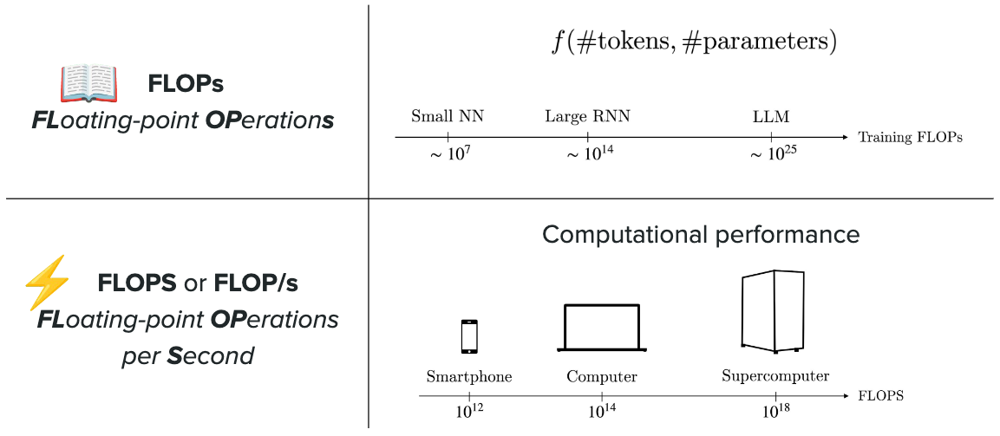

評估一張 GPU 時，最重要的規格有三個：

- TFLOPS：每秒能完成多少兆次浮點運算，代表 GPU 的運算速度。
- GPU memory (VRAM)：GPU 上的記憶體容量，決定放得下多少東西，包括模型權重本身，以及推論過程中產生的中間數值 (例如 activation 等)。
- GPU memory bandwidth：資料在 VRAM 與運算單元之間搬移的速度，決定運算單元能多快拿到所需的權重與資料。

### 記憶體有限與運算成本高昂

拿這些規格去對照 LLM 的規模，會碰到以下兩個挑戰：

- 記憶體有限：以一個 100B 參數的模型為例，若每個參數用 FP16 儲存 (2 bytes)，光是權重就需要 200GB，已經超出單張 GPU 的記憶體上限 (例如 H200 是 141GB)。訓練時的情況更糟，除了 activation 之外，還得額外存放 gradient 與 optimizer state。
- 運算成本高昂：不論是 training 還是 inference，都需要大量的矩陣運算，所以兩者都很昂貴。

今天的課程重點就在於解決這兩個挑戰，也就是怎麼讓模型放得進 GPU，以及怎麼讓模型跑得快。

## FlashAttention

接下來先從單張 GPU 的內部著手，看看可以怎麼緩解這兩個挑戰。

第一個要講的是 [FlashAttention](https://arxiv.org/abs/2205.14135) (Dao et al., 2022)，它的目標是讓 attention 在單張 GPU 上算得更快、也更省記憶體。

### 標準 attention 為何頻繁進出 HBM

過去的問題出在 self-attention 的核心運算：

$$
\text{softmax}\left(\frac{QK^\top}{\sqrt{d_k}}\right)V
$$

其中 $S = QK^\top$ 是一個 $n \times n$ 的矩陣 ($n$ 是序列長度)，每個元素是某個 query 對某個 key 的分數，當序列一長，這個矩陣就會非常龐大，例如 $n = 8192$、FP16 時，單一個 head 就要約 134MB。

但在理解 FlashAttention 怎麼處理這個問題之前，得先看 GPU 內部的記憶體階層：

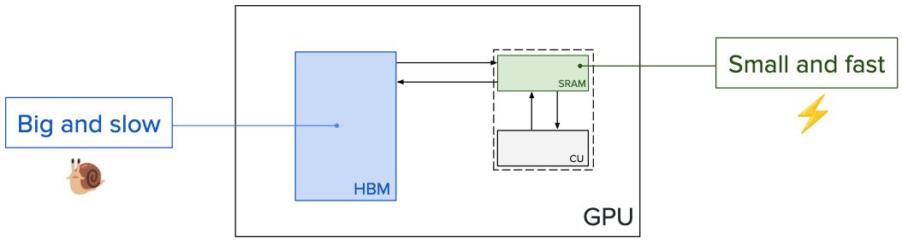

其中 HBM (High Bandwidth Memory，也就是前面提到的 VRAM) 是 off-chip memory，容量大但速度慢；SRAM 則是 on-chip memory，位在運算單元旁邊，容量小 (每個 SM 只有數百 KB) 但速度快 (off-chip 指的是 HBM 不在 GPU 晶片上，而是以獨立的記憶體顆粒堆疊在晶片旁邊、透過封裝內的線路連接；on-chip 則是直接做在 GPU 晶片內部，資料不用離開晶片，所以快得多)。

運算單元 (CU) 只能直接處理 SRAM 裡的資料，HBM 的資料必須先搬進 SRAM 才能計算，所以 FlashAttention 的中心思想，就是減少資料進出 HBM 的次數。

而標準做法之所以頻繁進出 HBM，問題其實在於 softmax 的分母：

$$
\text{softmax}(x)_i = \frac{e^{x_i}}{\sum_{j=1}^{n} e^{x_j}}
$$

分母必須等整個 row 處理完才算得出來 (softmax 是對 $S$ 的每個 row 各自做的，分母加總的是同一個 query 對所有 key 的分數，不會跨 row，這樣每個 query 分給所有 key 的權重加起來才會剛好是 1)。因此標準的 self-attention 會拆成三步，其中每一步都得經過 HBM：

1. 計算 S：從 HBM 分塊讀出 $Q$、$K$，算出 $S = QK^\top$ 後寫回 HBM。
2. 計算 P：從 HBM 讀出 $S$，算出 $P = \text{softmax}(S)$ 後寫回 HBM。
3. 計算 O：從 HBM 分塊讀出 $P$、$V$，算出 $O = PV$ 後寫回 HBM。

這些計算之所以不能算完直接接著算，是因為 $S$ 和 $P$ 都是 $n \times n$，遠超過 SRAM 的容量，而 softmax 又得等整個 row 到齊才能 normalize，下一步無法提前開始 (這三步在實作上是三個獨立的 kernel，SRAM 裡的資料在 kernel 結束後不會保留，只能透過 HBM 交接)，最終導致兩個 $n \times n$ 的矩陣在 HBM 進出了好幾次。

### 把 softmax 拆成分子 N 與分母 D

而 FlashAttention 則透過「把 softmax 和乘上 $V$ 合在一起看」這個小技巧，找到了突破口。

先固定一個 query，令它對 $n$ 個 key 的分數為 $s = (s_1, \dots, s_n)$，$V$ 的 $n$ 個 row 為 $v_1, \dots, v_n$ ($s_i$ 是 scalar；$v_i$ 是第 $i$ 個 token 的 value，是一個 $d$ 維向量)，目標是算出：

$$
\text{softmax}(s)\,v = \sum_{i=1}^{n} \frac{e^{s_i}}{\sum_{j=1}^{n} e^{s_j}} v_i
$$

也就是 $O$ 的其中一個 row (把所有 token 的 value 依權重加總)，這個小技巧的關鍵在於分母對外層加總的每一項來說都是同一個常數，所以可以整個提出來：

$$
\sum_{i=1}^{n} \frac{e^{s_i}}{\sum_{j=1}^{n} e^{s_j}} v_i = \frac{\sum_{i=1}^{n} e^{s_i} v_i}{\sum_{j=1}^{n} e^{s_j}} = \frac{N}{D}
$$

其中 $N$ 是分子 (numerator)、$D$ 是分母 (denominator)。

拆開後兩者都只是沿著 key 方向的總和，而且跑的是同一組 key，所以能在同一次掃描中邊讀邊累加 ($i$ 和 $j$ 只是 dummy index，原式用不同字母是因為分母巢狀在外層加總裡；拆開後換成同一個字母也一樣)。

這裡將「到第 $t$ 個 key 為止的部分和」定義為：

$$
N_t = \sum_{i=1}^{t} e^{s_i} v_i, \qquad D_t = \sum_{j=1}^{t} e^{s_j}
$$

就能得到遞迴關係 (像課程中一樣實際帶入數值也能歸納出來)：

$$
N_{t+1} = N_t + e^{s_{t+1}} v_{t+1}, \qquad D_{t+1} = D_t + e^{s_{t+1}}
$$

每讀進一個 key 與對應的 value，就把新的一項加到目前的總和上，看完全部 $n$ 個之後，$N_n / D_n$ 就是答案。

注意，這裡的重點在於除法只在最後做一次，如此一來 softmax 對整個 row 的依賴就消失了。

### 數值穩定性與 online softmax

不過直接計算 $e^{s_i}$ 會有數值穩定性的問題 (FP16 能表示的最大值約 65504，$s_i$ 只要超過 11 左右，$e^{s_i}$ 就會 overflow)。

這裡解決數值穩定性的小技巧是「分子分母同乘一個常數不影響比值」這個小學生都知道的概念 (但常數選得很聰明)：

$$
\frac{N}{D} = \frac{C \times N}{C \times D}, \qquad C = e^{-\max_i s_i}
$$

這樣每一項都變成 $e^{s_i - \max_i s_i} \le 1$ (較小的項可能 underflow 成 0，但它們的貢獻本來就小到可以忽略；而最大值那一項恆為 $e^0 = 1$，分母至少是 1，不會除以 0)。

問題是逐步累加時還不知道整個 row 的最大值，只知道目前看過的最大值，所以改用 running max $m_t$ 當基準。

第一步時 $m_1 = s_1$：

$$
N_1 = e^{s_1 - m_1} v_1, \qquad D_1 = e^{s_1 - m_1}
$$

讀進第二個 key 後，最大值可能改變，$m_2 = \max(s_1, s_2)$。

但 $N_1$ 是以 $m_1$ 為基準算的，必須先乘上 $e^{m_1 - m_2}$ 換算到新基準，才能和新的一項相加 (不然小學生技巧就會失效！)：

$$
N_2 = e^{m_1 - m_2} \cdot e^{s_1 - m_1} v_1 + e^{s_2 - m_2} v_2 = e^{s_1 - m_2} v_1 + e^{s_2 - m_2} v_2
$$

乘上 $e^{m_1 - m_2}$ 之後，第一項的基準確實從 $m_1$ 換成了 $m_2$，$D_2$ 也是同樣的道理。

推廣到一般情況，就能得到 online softmax 的更新規則：

$$
\left\{\begin{matrix} m_{t+1} = \max(m_t, s_{t+1}), \qquad \alpha_t = e^{m_t - m_{t+1}} \\ N_{t+1} = \alpha_t N_t + e^{s_{t+1} - m_{t+1}} v_{t+1}, \qquad D_{t+1} = \alpha_t D_t + e^{s_{t+1} - m_{t+1}} \end{matrix}\right.
$$

其中 $m_{t+1}$ 是新的基準，$\alpha_t$ 負責把到目前為止的累加結果換算到新基準 (若最大值沒變，$\alpha_t = 1$)。

看完全部 $n$ 個 key 後 $m_n = \max_i s_i$，分子分母帶著同一個 $e^{-m_n}$，相除後剛好消掉，所以結果和原本的 softmax 完全相同 (FlashAttention 是 exact attention，不是近似)。

實作上可以從 $m_0 = -\infty$、$N_0 = 0$ (零向量，因為 $N$ 累加的是 $d$ 維向量)、$D_0 = 0$ 開始套用同一組規則，第一步就會自然得到 $m_1 = s_1$ ($\alpha_0 = e^{-\infty} = 0$，乘上原本就是 0 的 $N_0$、$D_0$ 不影響結果)。

### Tiling 與 kernel fusion

有了這個技巧，就能用 tiling 的方式在 SRAM 裡完成整個 attention：把 $Q$ 的一個 row block 讀進 SRAM 並固定住，再把 $K^\top$ 的 column block 與 $V$ 對應的 row block 成對地一塊一塊送進來 (第 $i$ 個 key 和第 $i$ 個 value 屬於同一個 token)，每讀進一塊就算出分數、更新 $m$、$N$、$D$，用完的區塊直接被下一塊覆蓋。掃完所有 $K$、$V$ 後算出 $N_n / D_n$，把這個 block 的 $O$ 寫回 HBM，再換下一個 $Q$ block。整個過程中 $S$ 和 $P$ 都不會寫進 HBM，中途值也都留在 SRAM，只有最終的 $O$ 寫回一次。

也就是說，由於 softmax 對整個 row 的依賴已經消失，原本得拆成三個 kernel、透過 HBM 交接的計算分數、更新累加器、乘上 $V$，現在能合併在同一個 kernel 裡完成，這就是所謂的 kernel fusion (kernel 指的是在 GPU 上執行的一個函式，kernel 結束後 SRAM 裡的資料就不會保留)：

<iframe src="/interactive/cme295-flashattention-steps/index.html" width="100%" height="640" loading="lazy" title="FlashAttention 逐塊計算單一 query 的互動示意" data-autoheight style="border:0;overflow:hidden"></iframe>

上面的動畫為了看清楚數值，每塊只放一個 token；實際上每塊包含數十到上百個 token，數學結構不變，只是一次處理一整塊 (另外，固定 $Q$、串流 $K$ 與 $V$ 是 FlashAttention-2 的迴圈順序；最初的 FlashAttention 外層跑的是 $K$ 與 $V$，每處理一塊都要把各個 $Q$ block 的部分結果從 HBM 讀出、更新再寫回，但 $S$、$P$ 一樣不會寫進 HBM)。

### Backward 的重算與實驗結果

到這裡處理的是 forward pass，訓練時還有 backward pass，而計算 gradient 需要用到 $S$ 和 $P$，標準做法會把它們存在 HBM 留給 backward 使用。但 FlashAttention 的第二個想法是：有時候重算比儲存更划算。因此它在 forward 時只額外存下每個 row 的一個統計量 (由 $m_n$ 與 $D_n$ 組成的 logsumexp)，backward 時再用同樣的 tiling 在 SRAM 裡把 $S$、$P$ 一塊一塊重算出來。

即使重算會增加運算量，但省下了大量讀寫 HBM 的時間，整體反而更快。

實驗結果也印證了這點。在論文對 GPT-2 medium 的 attention 測試中 (seq. length 1024、A100 GPU，計算 forward + backward)，FlashAttention 的運算量從 66.6 GFLOPs 增加到 75.2 GFLOPs (多出來的部分主要來自 backward 時的重算)，但 HBM 讀寫量從 40.3 GB 降到 4.4 GB，執行時間也從 41.7 ms 降到 7.3 ms。運算量變多卻跑得更快，是因為 attention 是 memory-bound 的運算 (GPU 的時間主要花在等資料從 HBM 搬過來，而不是計算本身)，FlashAttention 改善的是前面提到的 memory bandwidth 瓶頸，而不是 TFLOPS。之後的版本持續針對新一代 GPU 優化，包括 [FlashAttention-2](https://arxiv.org/abs/2307.08691) (Dao, 2023)、針對 Hopper 架構的 [FlashAttention-3](https://arxiv.org/abs/2407.08608) (Shah et al., 2024)，以及針對 Blackwell 架構的 FlashAttention-4。

總結來說，FlashAttention 同時回應了前面的兩個挑戰：在記憶體方面，它避免了 materialize 整個 $n \times n$ 的 attention matrix (也就是不把整個矩陣實際存進記憶體，額外用量從 $O(n^2)$ 降到 $O(n)$)；在速度方面，它大幅減少了 HBM 的讀寫。

不過它只優化了 attention 這一步，200GB 的模型權重依然放不進單張 GPU，這正是接下來 distributed training 要處理的問題。

## Distributed training

### 訓練時要存的資料與 Adam 的 optimizer state

這裡要談的是怎麼把訓練分散到多張 GPU 上，首先來盤點訓練時 GPU 上到底需要存哪些東西。

訓練的每一步可以拆成 forward pass、backward pass 與 weights update，每個階段都會留下需要儲存的資料：

- Parameters：模型參數本身，數量從數十億到上兆不等。
- Activations：forward pass 時各層的中間輸出，計算 loss 與之後的 gradient 都需要用到，大小取決於 model size、batch size 與 context length。
- Gradients：backward pass 算出的 $\nabla \mathcal{L}(\theta_t)$，每個參數各有一個，用來更新權重。
- Optimizer state：optimizer 更新權重時需要的額外狀態。

以最常用的 [Adam](https://arxiv.org/abs/1412.6980) (Kingma et al., 2014) 為例 (實務上多用加上 decoupled weight decay 的 [AdamW](https://arxiv.org/abs/1711.05101) (Loshchilov et al., 2017))，更新規則為：

$$
\theta_{t+1} \leftarrow \theta_t - \alpha \frac{m_t}{\sqrt{v_t} + \epsilon}, \qquad \left\{\begin{matrix} m_t \leftarrow \beta_1 m_{t-1} + (1-\beta_1)\nabla \mathcal{L}(\theta_t) \\ v_t \leftarrow \beta_2 v_{t-1} + (1-\beta_2)(\nabla \mathcal{L}(\theta_t))^2 \end{matrix}\right.
$$

其中 $\alpha$ 是 learning rate，$m_t$ 是 gradient 的移動平均 (first moment)，$v_t$ 是 gradient 平方的移動平均 (second moment)，也就是說每個參數都要額外存兩個狀態 (注意這裡的 $\alpha$、$m_t$、$v_t$ 和 FlashAttention 的縮放係數、running max、value 無關，只是剛好撞名)。

把這些加起來，就會發現訓練比推論吃記憶體得多。以常見的 mixed precision 訓練為例 (參數與 gradient 用 FP16 存，optimizer 另外以 FP32 保留一份參數與 $m_t$、$v_t$)，每個參數需要 $2 + 2 + (4 + 4 + 4) = 16$ bytes，前面 100B 參數的模型光是這些 model states 就要 1.6TB，還沒算 activations，而一張 H200 只有 141GB。

### 從資料下手：DP 與 ZeRO

因此訓練勢必得把這些資料切分到多張 GPU 上，第一類做法是從資料下手：

- DP (Data Parallelism)：每張 GPU 都放一份完整的模型，各自處理不同的資料 batch，backward 後用 all-reduce (把所有 GPU 的值加總，並讓每張 GPU 都拿到加總結果) 同步 gradient，讓所有副本做出相同的更新，它能同時處理更多資料、加快訓練，但完全沒有節省記憶體，每張 GPU 仍要存下完整的 16 bytes/參數，代價則是每一步都要同步一次 gradient。

  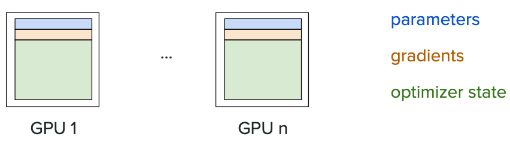

- ZeRO (Zero Redundancy Optimizer)：DP 的浪費在於每張 GPU 都存了一模一樣的 model states，[ZeRO](https://arxiv.org/abs/1910.02054) (Rajbhandari et al., 2019) 則把這些重複的資料切成 $N_d$ 份 ($N_d$ 是 DP 的 GPU 數)，每張 GPU 只保管其中一份。注意，ZeRO 切的是儲存而不是計算，它本質上仍是 DP，每張 GPU 依然處理各自的 batch、跑完整個模型的 forward 與 backward，並算出所有參數的 gradient。之所以能切開，是因為 Adam 的更新是逐元素的 (更新 $\theta_k$ 只需要它自己的 $g_k$、$m_k$、$v_k$)，所以可以把所有參數攤平成一條向量、切成 $N_d$ 段，每張 GPU 只負責更新其中一段。依切分範圍分成三個階段：ZeRO-1 只切 optimizer state，backward 後先同步 gradient，每張 GPU 用自己保管的 $m$、$v$ 更新負責的那段參數，再用 all-gather (把各 GPU 的片段收集起來，讓每張 GPU 都拿到完整結果) 拼回完整參數；ZeRO-2 再切 gradient，改用 reduce-scatter (加總後每張 GPU 只拿自己負責的那段) 取代 all-reduce，因為每張 GPU 只負責更新自己那段參數，加總後其他段的 gradient 也用不到，不必保存；ZeRO-3 連參數都切，每一層在 forward 與 backward 前才 all-gather 出該層的完整參數，用完就丟。雖然每個參數只由一張 GPU 更新，但它用的 gradient 已經加總了所有 GPU 的結果，更新完又會同步回每張 GPU，所以結果和 DP 完全相同。

  但每個參數的記憶體因此從 16 bytes 依序降到 $4 + 12/N_d$、$2 + 14/N_d$ 與 $16/N_d$ bytes；ZeRO-1、2 的通訊量和 DP 相同 (一次 all-reduce 本來就等於一次 reduce-scatter 加一次 all-gather)，ZeRO-3 則因為要反覆收集參數，通訊量增加到 DP 的 1.5 倍：

  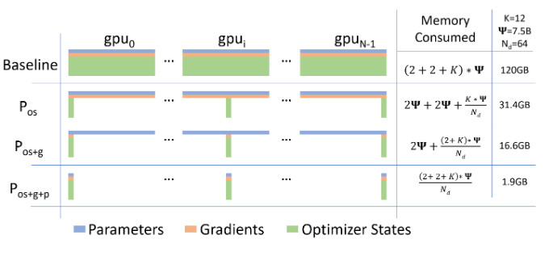

### Model parallelism：TP、PP、CP 與 EP

但 DP 與 ZeRO 切的都是 model states，每張 GPU 仍要跑完整個模型的計算，activations 也沒有減少。

另一類做法是 model parallelism，直接把模型的計算拆到多張 GPU 上，依切法不同分成以下幾種：

- TP (Tensor Parallelism)：在同一層內部切開權重矩陣。以 [Megatron-LM](https://arxiv.org/abs/1909.08053) (Shoeybi et al., 2019) 的 FFN 為例，第一個矩陣沿 column 切成 $A = [A_1, A_2]$，每張 GPU 各自算出 $Y_i = \text{GeLU}(XA_i)$ (因為 $XA = [XA_1, XA_2]$，而 GeLU 是逐元素運算，所以不需要先交換資料)；第二個矩陣則沿 row 切成 $B = [B_1; B_2]$，由於 $YB = Y_1 B_1 + Y_2 B_2$，最後只要一次 all-reduce 把各 GPU 的結果加總即可。Attention 則直接按 head 切開 (各 head 本來就獨立計算)。每張 GPU 只需存一部分的參數 (以及對應的 gradient、optimizer state) 與 activations，但每一層在 forward 與 backward 都需要 all-reduce，通訊頻繁又卡在計算的關鍵路徑上，通常只在同一台機器內、透過 NVLink 這類高速互連使用 (H200 的 NVLink 是 900GB/s，PCIe Gen5 只有 128GB/s)。

  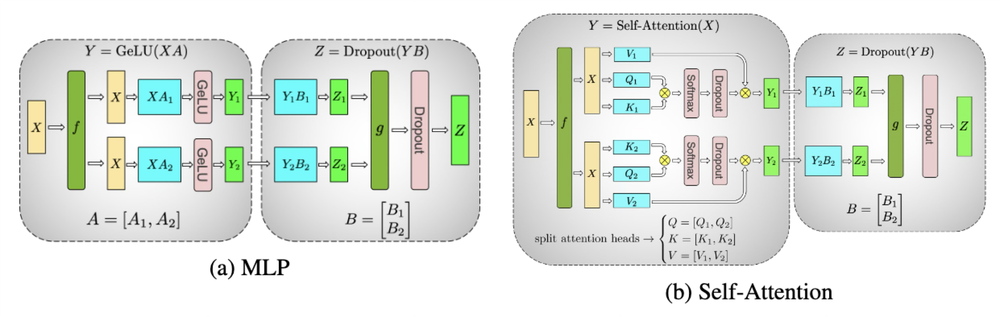

- PP (Pipeline Parallelism)：以層為單位切開模型，每張 GPU 只負責連續的幾層 ([GPipe](https://arxiv.org/abs/1811.06965) (Huang et al., 2018))，GPU 之間只需傳遞交界處的 activations (backward 時則傳 gradient)，通訊量比 TP 少得多，因此可以跨機器使用。代價是每張 GPU 都得等上一段算完才能開始，一次只送一個 batch 的話，同一時間只有一張 GPU 在工作；GPipe 把 batch 切成多個 micro-batch 依序送進 pipeline，但開頭與結尾仍有 GPU 閒置的 bubble (以 $p$ 個 stage、$m$ 個 micro-batch 來說，閒置比例約為 $\frac{p-1}{m+p-1}$，圖中 4 個 stage、4 個 micro-batch 時約有 43%)，而且 micro-batch 越多，每張 GPU 要暫存的 activations 也越多。

  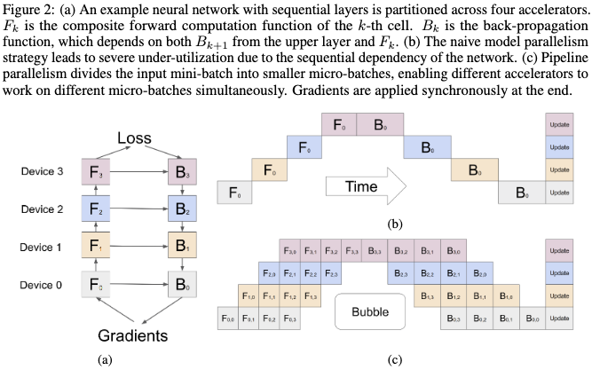

- CP (Context Parallelism)：沿著序列長度切開，每張 GPU 只負責一段 token。以 [Ring Attention](https://arxiv.org/abs/2310.01889) (Liu et al., 2023) 為例，每張 GPU 固定自己的 query block，key 與 value 的 block 則沿著環狀排列的 GPU 依序傳遞，每收到一塊就更新一次 attention 結果 (FFN 本來就是逐 token 計算，不需要通訊)。

  以兩個 token、兩張 GPU 為例：一開始 GPU-1 放著第 1 個 token 的 $Q_1, K_1, V_1$，GPU-2 放著第 2 個 token 的 $Q_2, K_2, V_2$。一開始兩張 GPU 可以各自用手上的 key 與 value 計算 attention，例如 GPU-1 用 $Q_1$ 對 $K_1, V_1$ 初始化累加器 $m, N, D$，同時把自己的 $K, V$ 傳給下一張 GPU；第二步，GPU-1 收到 $K_2, V_2$、GPU-2 收到 $K_1, V_1$，各自用 online softmax 的更新規則把新的一塊併入累加器，看完所有 block 後再算出 $N / D$。整個過程中 query 和 output 都不會離開原本的 GPU，在環上流動的只有 key 與 value。不過 Decoder-only 的 LLM 有 causal mask，$Q_1$ 不能看到第 2 個 token，所以 GPU-1 收到 $K_2, V_2$ 後會直接跳過這一塊，只有 GPU-2 需要用到 $K_1, V_1$ (這也導致越前面的 GPU 工作量越少，實務上會重新安排 token 的分配來平衡負載)。這和 FlashAttention 在 SRAM 裡串流 $K$、$V$ 是同一個 online softmax 技巧，只是把 SRAM 換成了其他 GPU，它讓 activations 隨序列長度分散到各 GPU，是訓練長 context 的關鍵；代價是 KV block 的傳遞，但傳下一塊的同時可以計算目前這塊，所以通訊時間能和計算重疊。

  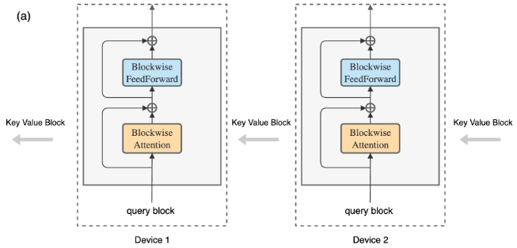

- EP (Expert Parallelism)：專為 MoE (Mixture of Experts) 設計。回顧一下 MoE，FFN 層被換成多個 expert，由 router $G$ 為每個 token 挑選要送去哪個 expert。[GShard](https://arxiv.org/abs/2006.16668) (Lepikhin et al., 2020) 把不同的 expert 放在不同的 GPU 上，其餘的層 (例如 attention) 則每張 GPU 各放一份、處理各自的資料。token 經過 gating 後，透過 all-to-all dispatch (每張 GPU 都把資料分送給其他所有 GPU) 送到負責該 expert 的 GPU，算完再用 all-to-all combine 送回原本的 GPU。由於 MoE 的參數大多集中在 expert，EP 能有效分攤參數；代價是每個 MoE 層都要兩次 all-to-all，而且若 router 偏好某些 expert，負責它們的 GPU 就會過載 (load imbalance)。

  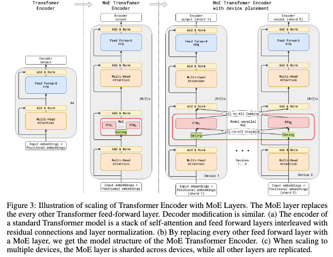

### 為什麼不盡可能地平行化

上述所有方法都能分攤記憶體，但實務上我們並不會盡可能地平行化，這是因為主要有以下三個限制：

- 使用率低：切得越細，每張 GPU 分到的工作越少，等待通訊或 bubble 的時間占比就越高。
- GPU 很貴：多一張 GPU 就多一份成本，閒置的 GPU 是純粹的浪費。
- 通訊成本：GPU 之間的頻寬遠低於 HBM (H200 的 HBM 頻寬是 4.8TB/s，NVLink 是 900GB/s)，通訊越多，時間就越容易卡在傳輸上。

所以實務上會依各方法的通訊特性組合使用，例如通訊最頻繁的 TP 放在同一台機器內，PP 與 DP 再跨機器擴展。

總結來說，distributed training 同樣回應了前面的兩個挑戰：在記憶體方面，把 parameters、activations、gradients 與 optimizer state 分散到多張 GPU 上；在速度方面，DP 讓不同的 batch 平行處理，model parallelism 則讓模型本身的計算平行化。

## Inference optimizations

### Prefill 與 decode

訓練好的模型終究要拿來 serve，我們先從一個問題來開始推論時效能的討論，請問以下兩個 request 哪一個比較快？

1. 輸入 10 個 token (請模型寫一個床邊故事)，輸出 10,000 個 token。
2. 輸入 10,000 個 token (一大段描述)，輸出 10 個 token。

答案是第二個，原因是處理輸入與產生輸出的成本截然不同。

一個 request 的總時間可以拆成：

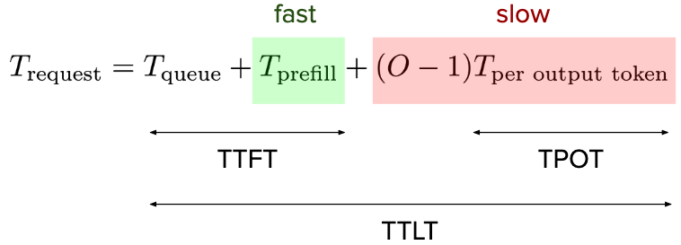

其中 $T_\text{queue}$ 是排隊等待被處理的時間；$T_\text{prefill}$ 是處理整個 prompt 並產生第一個 output token 的時間；$O$ 是 output token 數，剩下的 $O - 1$ 個 token 各要花 $T_\text{per output token}$ (這個階段稱為 decode)。

而 prefill 之所以快，是因為 prompt 的所有 token 都已知，可以在一次 forward pass 裡平行算完 (和訓練時的 forward 一樣，靠 causal mask 讓每個 token 只看到前面的 token)；decode 則是 auto-regressive 的，每一步都得等上一個 token 生成才能開始，只能依序一個一個產生。

### 三個指標與改善目標

從這條公式可以定義三個常見的指標：

- TTFT (Time To First Token)：從送出 request 到收到第一個 token 的時間，即 $T_\text{queue} + T_\text{prefill}$，決定使用者要等多久才看到回應開始出現。
- TPOT (Time Per Output Token)：第一個 token 之後，每個 output token 的生成時間，即 $T_\text{per output token}$，決定之後文字串流的速度。
- TTLT (Time To Last Token)：收到最後一個 token 的時間，也就是整個 $T_\text{request}$。

其中前兩個因為只取決於系統本身，而且直接對應使用者的體感，所以是做 infra 時最關心的指標。而 TTLT 則取決於 output token 數 $O$，而 $O$ 由模型的行為與任務決定 (例如 reasoning model 會先產生大量的思考 token)，不是 infra 能控制的，所以較少作為改善時的目標。

另外，prefill 與 decode 的成本差異也反映在定價上，[OpenAI](https://openai.com/api/pricing/)、[Anthropic](https://docs.claude.com/en/docs/about-claude/pricing) 與 [Google](https://ai.google.dev/gemini-api/docs/pricing) 的 output token 價格通常都是 input token 的 5 倍左右，也就是生成一個 token 的成本遠高於讀進一個 token。

因此推論系統的改善目標可以歸納為以下三個：

- 快：TTFT $< \tau_1$ 且 TPOT $< \tau_2$。
- 高品質： Quality $> Q_\text{min}$。
- 便宜：每個生成 token 的成本 $< C_\text{max}$。

### 從 H200 規格到 roofline model

其中品質主要取決於模型本身，infra 能夠控制的只剩快與便宜，但要做到這兩點，得先回到前面提過的 [H200](https://www.nvidia.com/en-us/data-center/h200/) 規格，把它們定義得更精確：

- Computational throughput：每秒能完成多少運算，單位是 FLOPS。precision 越低，TFLOPS 越高，從 FP64 的 34 TFLOPS、FP16 的 1,979 TFLOPS，到 FP8 的 3,958 TFLOPS (Tensor Core 是專門做矩陣乘法的運算單元，所以同樣的 precision 也會快上許多；另外規格表上 Tensor Core 的數字是在 sparsity 下測得的，一般 dense 運算約為一半)。
- Memory bandwidth：每秒能從 HBM 搬多少資料，單位是 bytes/s，H200 為 4.8TB/s。
- Arithmetic intensity：每搬一個 byte 能做多少運算，即 $I = \frac{\text{FLOPs}}{\text{bytes moved}}$，單位是 FLOPs/byte，取決於演算法本身 (前兩者則屬於硬體規格)。

把這些數字放回 GPU 的架構圖，數量級大約是：

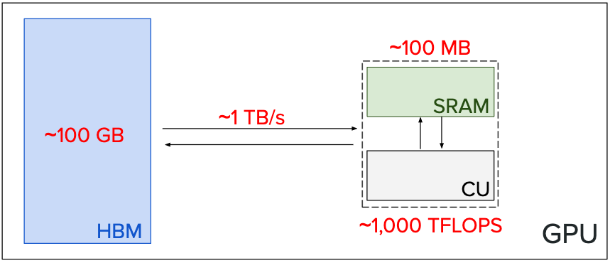

可以看到運算的速度 $\gg$ 資料搬運的速度，兩者的關係可以用 [roofline model](https://dl.acm.org/doi/10.1145/1498765.1498785) 描述：

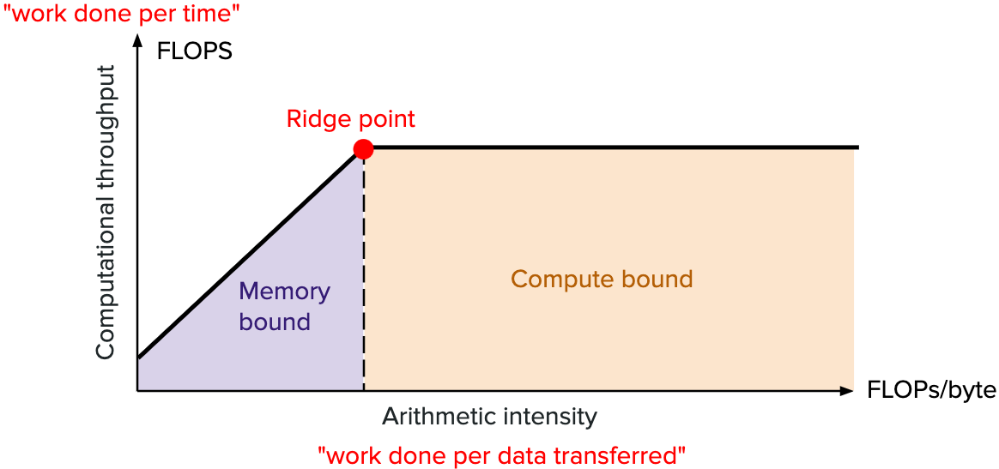

依照此模型，一個運算能達到的 throughput 上限為：

$$
P_\text{roof} = \min(P_\text{max},\; I \times B_\text{HBM})
$$

其中 $I$ 是前面定義的 arithmetic intensity，$P_\text{max}$ 是 GPU 的峰值運算能力，$B_\text{HBM}$ 是 memory bandwidth，$I \times B_\text{HBM}$ 的單位是 (FLOPs/byte) × (bytes/s) = FLOPs/s，代表「資料搬運速度所能支撐的運算速度」，也就是每秒能搬進多少 bytes，乘上每個 byte 能做多少運算。

當 $I$ 很小時，運算單元一直在等資料，throughput 受限於 $I \times B_\text{HBM}$，稱為 memory bound；當 $I$ 夠大時，資料來得及供應，throughput 就卡在 $P_\text{max}$，稱為 compute bound，兩者的交界點 (ridge point) 為：

$$
I^\star = \frac{P_\text{max}}{B_\text{HBM}}
$$

以 H200 的 BF16 dense 約 989 TFLOPS、4.8TB/s 計算，$I^\star \approx 206$ FLOPs/byte，也就是每搬一個 byte 至少要做約 200 次運算，才能把運算單元餵飽 (前面說 attention 是 memory-bound，指的就是它落在 ridge point 的左邊)。

### 為什麼 decode 是 memory bound

透過這個模型就能解釋 prefill 與 decode 的快慢差異，考慮一個 $d \times d$ 的權重矩陣 (BF16，每個元素 2 bytes)：decode 每一步只處理 1 個 token，是一次矩陣乘向量，運算量約 $2d^2$ FLOPs (每個權重做一次乘法加一次加法)，卻要把 $2d^2$ bytes 的權重從 HBM 讀進來，$I \approx 1$ FLOP/byte，遠低於 $I^\star$，是典型的 memory bound；prefill 則是 $L$ 個 token 一起算，同一份權重被重複使用 $L$ 次，運算量變成 $2Ld^2$，搬運量卻幾乎不變，$I \approx L$，prompt 夠長時就進入 compute bound。

換句話說，decode 慢不是因為運算量大，而是每生成一個 token，都要把整個模型的權重從 HBM 重新搬一次，運算單元大部分時間都在等資料，這也是 output token 比較貴的原因。

因此接下來的討論的推論改善方案，基本上都圍繞在如何提高 decode 的 arithmetic intensity，或減少它要搬運的資料量。

## KV cache 與它的三個問題

前面提到 decode 慢在每一步都要從 HBM 搬大量資料，因此接下來的改善會集中在 attention 這一層。

### KV cache 的做法與代價

先看 decode 時 attention 做了什麼：第 $t$ 步生成新 token 時，它的 query 必須和所有之前 token 的 key 與 value 互動：

$$
o_t = \text{softmax}\left(\frac{q_t K_{1:t}^\top}{\sqrt{d_k}}\right) V_{1:t}
$$

其中 $q_t$ 是新 token 的 query，$K_{1:t}$、$V_{1:t}$ 是第 1 到第 $t$ 個 token 的 key 與 value 疊成的矩陣。

如果每一步都重新跑一次 forward，前面所有 token 的 key 與 value 都得重算，但這些計算完全是重複的 (因為 causal mask，每個 token 在每一層的表示都只取決於它自己和前面的 token，後面新增的 token 不會改變它們，所以舊 token 的 key 與 value 永遠不變)。

KV cache 的做法就是把算過的 key 與 value 存起來，每一步只需要算新 token 的 $q_t, k_t, v_t$，把 $k_t, v_t$ 加進 cache，再拿 $q_t$ 和整個 cache 計算 attention (query 不需要 cache，因為舊 token 的 query 只在它自己那一步用，之後不會再用到)。

以「a cute teddy bear」為例，生成到 teddy bear 時，$k_\text{a}, k_\text{cute}$ 與 $v_\text{a}, v_\text{cute}$ 都直接從 cache 讀取，只有 $q_\text{teddy bear}, k_\text{teddy bear}, v_\text{teddy bear}$ 需要新算：

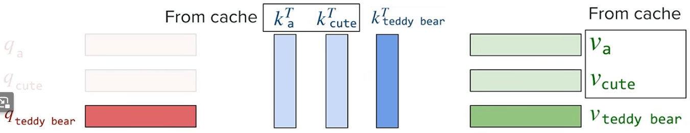

所以實務上，prefill 除了產生第一個 output token，同時也把整個 prompt 的 key 與 value 一次算好、填進 KV cache，之後的 decode 只需要不斷往 cache 後面追加就好。

但代價也很明顯是記憶體，每個 token 在每一層、每個 head 都要存一組 key 與 value，大小為：

$$
2 \times n_\text{layers} \times n_\text{heads} \times d_\text{head} \times \text{bytes per element}
$$

前面的 2 代表 key 與 value 各一份，以 Llama 2 7B 為例 (32 層、32 個 head、$d_\text{head} = 128$、FP16)，每個 token 約需 0.5MB，一個 4,096 token 的序列就要約 2GB，而且 decode 的每一步都得把整個 cache 從 HBM 讀一次，讓本來就 memory-bound 的 decode 更加吃重頻寬。

同樣的想法也延伸到跨 request 的 prompt caching，如果多個 request 有相同的開頭 (例如同一份 system prompt 或文件)，就能直接重用這段前綴的 KV cache，省下重複的 prefill。

這也反映在 [OpenAI](https://openai.com/api/pricing/)、[Anthropic](https://docs.claude.com/en/docs/about-claude/pricing) 與 [Google](https://ai.google.dev/gemini-api/docs/pricing) 的定價上：命中 cache 的 input 價格約只有一般 input 的 1/10 到 1/20，而寫入 cache 則比一般 input 略貴，保存越久越貴。

### PagedAttention：以 block 管理記憶體

有了 KV cache 之後，下一個問題是怎麼管理這塊記憶體。

naive 的做法是為每個 request 預先保留一段連續的記憶體，大小足以容納 prompt 加上最大可能的 output 長度，但實際的 output 往往比上限短，多保留的部分就閒置在那裡，其他 request 也無法使用；當多個長度不一的 request 同時存在，記憶體裡就到處都是這種用不到的空隙 (fragmentation)。

而 [PagedAttention](https://arxiv.org/abs/2309.06180) (Kwon et al., 2023) 借用了作業系統 virtual memory 的 paging 概念：把 KV cache 切成固定大小的 block，每個 block 存 $B$ 個 token 的 key 與 value，需要時才分配新的 block，而且 block 不必在記憶體中連續，再用一張 lookup table 記錄每個 request 的第幾個 block 實際存在哪裡，如此一來，每個 request 最多只會浪費最後一個 block 裡沒填滿的空間 (少於 $B$ 個 token)：

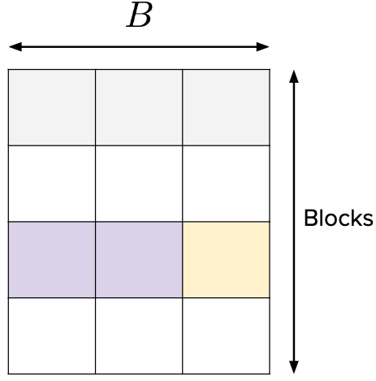

以 $B = 3$、兩個 request 為例，系統先把 GPU 記憶體切成一個個 physical block 放進共用的 pool。

request A 的 prompt 有 6 個 token，prefill 時剛好填滿 2 個 block，從 pool 拿到 physical block 7 與 1，block table 記成「logical 0 → 7、logical 1 → 1」；request B 的 prompt 有 2 個 token，拿到 physical block 4，只填了 2 格。

進入 decode 後，A 的第 7 個 token 因為現有的 block 都已填滿，才從 pool 再拿一個 physical block 2，並在 table 加上「logical 2 → 2」，第 8 個 token 則繼續填進 block 2；B 的第 3 個 token 填滿 block 4 剩下的 1 格，第 4 個 token 再拿到 physical block 5。此時 A 與 B 的 block 在記憶體中交錯排列 (1、2、7 屬於 A，4、5 屬於 B)，但每個 request 都能透過自己的 block table 依序找回自己的 key 與 value，attention kernel 也是依照 table 逐塊讀取來計算。

當 A 生成結束，它的 8 個 token 占用 3 個 block，只浪費最後一塊的 1 格，而這 3 個 block 會全部還回 pool，馬上可以分給 B 或新的 request 使用。

要注意的是，block size $B$ 本身也有取捨：$B$ 越小，浪費越少，但 block 數量變多，查表與零散讀取的計算開銷也越大；$B$ 越大，開銷越小，但最後一個 block 可能浪費的空間也越多，實務上常用 $B = 16$。

### GQA：讓 query head 共用 key 與 value

不過 PagedAttention 解決的只是「怎麼放」，KV cache 本身的大小並沒有改變，每個 token 在每一層、每個 head 都還是要存一組 key 與 value，向量數量依然太多。

這正是在 [第二堂課筆記](/posts/cme295-lecture-2-large-language-models/#mhamqa-%E8%88%87-gqa%E5%85%B1%E7%94%A8-kv) 提過的共享 attention head 能處理的問題，這裡只快速複習重點。

共享 attention head 的做法是把 $h$ 個 query head 分成 $G$ 組，同一組的 query head 共用一組 key 與 value head，所以 KV cache 的大小從 $2 \times n_\text{layers} \times h \times d_\text{head}$ 降為 $2 \times n_\text{layers} \times G \times d_\text{head}$，只剩原本的 $G/h$。依 $G$ 的大小分成三種：$G = 1$ 時所有 query head 共用同一組 key 與 value，稱為 [MQA](https://arxiv.org/abs/1911.02150) (Multi-Query Attention, Shazeer, 2019)；$G = h$ 時每個 query head 各有一組，就是原本的 MHA (Multi-Head Attention)；介於兩者之間的則是 [GQA](https://arxiv.org/abs/2305.13245) (Grouped-Query Attention, Ainslie et al., 2023)。

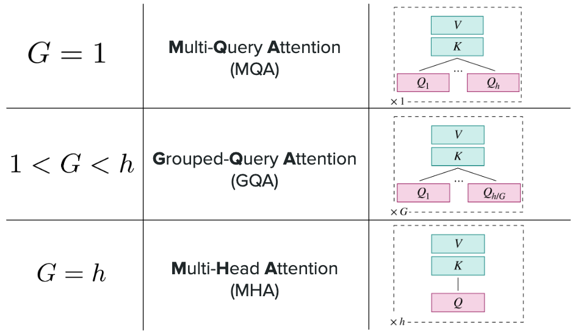

不過省下的記憶體是有代價的：在 MHA 中，每個 head 都能把 token 投影到自己的 key 與 value 空間，捕捉不同面向的關係；共用之後，同一組的 query head 只能在同一組 key 與 value 上分配注意力，模型的表達能力因此下降。

MQA 把 key 與 value 壓到只剩一組，雖然最省，但品質下降明顯，訓練也較不穩定；GQA 則在兩者之間取得平衡，品質接近 MHA，推論速度又接近 MQA，因此成為目前主流模型的常見選擇。

例如 $h = 24$、$G = 2$ 時 (見 [Qwen3.8-Flash-Next](https://huggingface.co/Qwen/Qwen3.8-Flash-Next) 的 model card)，KV cache 只剩原本的 $2/24$，省下超過 90%。

### MLA：只存壓縮過的 latent vector

GQA 減少的是向量的「數量」，但每個 key 與 value 向量本身還是很長，每個 token 在每一層都要存 $2 \times h \times d_\text{head}$ 個數值。

[DeepSeek-V2](https://arxiv.org/abs/2405.04434) (DeepSeek-AI, 2024) 提出的 MLA 換了一個方向：不直接存 key 與 value，而是存一個壓縮過的低維表示，需要時再還原：

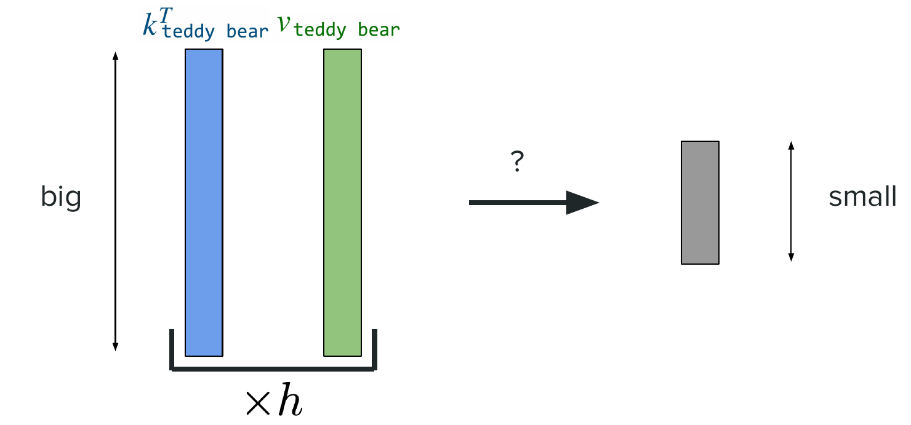

原本每個 head 都有自己的投影矩陣，把 token 的 hidden state $x_t$ 直接投影成 key，即 $k_t^{(i)} = W_K^{(i)} x_t$ ($i = 1, \dots, h$，value 同理)：

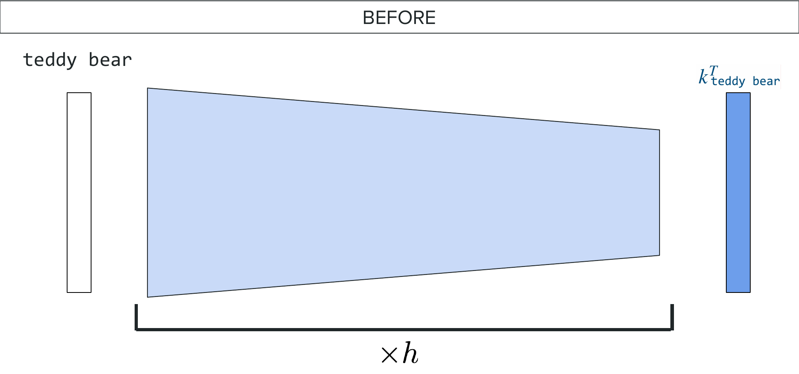

MLA 則把這個投影拆成兩段：先用所有 head 共享的 down-projection 把 $x_t$ 壓縮成一個低維的 latent vector，再用每個 head 各自的 up-projection 還原出 key 與 value：

$$
c_t = W^{D} x_t, \qquad k_t^{(i)} = W_K^{U(i)} c_t, \qquad v_t^{(i)} = W_V^{U(i)} c_t
$$

其中 $c_t$ 的維度 $d_c$ 遠小於 $2 \times h \times d_\text{head}$ (相當於把原本的投影矩陣限制成 low-rank 的形式 $W_K^{(i)} = W_K^{U(i)} W^D$)，由於每個 head 的 key 與 value 都能從同一個 $c_t$ 算出來，KV cache 只需要存 $c_t$ 就好：

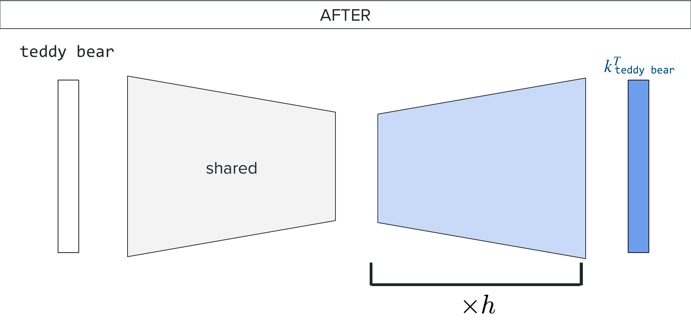

但可能有人會想問，這麼做的話，每一步 decode 不就都得把 cache 裡的 $c_j$ 還原成 key 與 value，不是會多出很多計算嗎？

MLA 的巧妙之處在於還原這一步可以吸收進其他矩陣裡，以 attention 分數為例：

$$
q_t^{(i)\top} k_j^{(i)} = q_t^{(i)\top} W_K^{U(i)} c_j = \left(W_K^{U(i)\top} q_t^{(i)}\right)^\top c_j
$$

只要先把 $W_K^{U(i)}$ 併到 query 那一側，就能直接拿 query 和 latent $c_j$ 算分數，完全不需要還原出 key；value 那側的 $W_V^{U(i)}$ 同理可以併進輸出的投影矩陣 $W_O$ (唯一的例外是 RoPE：它會依位置旋轉 query 與 key，讓上述合併不成立，所以 DeepSeek-V2 另外用一小段所有 head 共享的 key 專門攜帶位置資訊，稱為 decoupled RoPE)。

以 DeepSeek-V2 的設定為例 ($h = 128$、$d_\text{head} = 128$、$d_c = 512$，再加上 64 維的 RoPE key)，每個 token 每層只需存 576 個數值，而 MHA 要存 $2 \times 128 \times 128 = 32{,}768$ 個，只剩不到 2%，相當於只有 2.25 組的 GQA。和 GQA 不同的是，GQA 是強迫同一組的 head 使用完全相同的 key 與 value，MLA 則讓每個 head 仍透過自己的 up-projection 得到不同的 key 與 value，所以在論文的實驗中，品質甚至略優於 MHA。

代價是多了 down-projection 與 up-projection 的計算，但 decode 本來就是 memory-bound，用多一點運算換取更少的資料搬運，正好是划算的交易。

### 三個問題與三種解法

總結來說，KV cache 原本有三個問題，分別對應到三種解法：

- 記憶體破碎：用 PagedAttention 以 block 為單位管理記憶體。
- 向量太多：用 GQA 讓多個 query head 共用 key 與 value。
- 向量太長：用 MLA 只存壓縮過的 latent vector。

## Speculative decoding 與 MTP

### Speculative decoding：先猜再驗證

前面提到 decode 是 memory-bound，每生成一個 token 都要把整個模型的權重搬一次，但如果一次 forward pass 能處理多個 token，同一份權重就能被重複使用，成本幾乎和處理一個 token 相同 (就像 prefill 一樣)。

[Speculative decoding](https://arxiv.org/abs/2302.01318) (Chen et al., 2023) 正是利用這點：先用一個小的 draft model 依序快速猜出 $k$ 個 token，再讓原本的大模型 (target model) 用一次 forward pass 同時驗證它們。

以「my teddy bear」為例，draft model 猜出「is cute and smart」這 4 個 token，target model 把它們接在 context 後面跑一次 forward，就能同時得到每個位置的機率分布 $T_1, \dots, T_{k+1}$ (第 $i$ 個位置的分布會用來檢查第 $i$ 個猜測)：

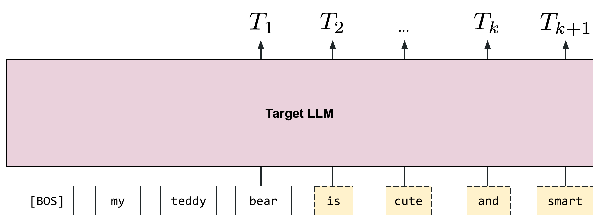

接著從第一個猜測開始依序檢查，令 $x$ 為 draft model 在第 $i$ 個位置猜的 token，$D_i$ 為 draft model 在該位置的分布：

- 若 $T_i(x) \ge D_i(x)$：target model 比 draft model 更有信心，直接接受。
- 否則以 $T_i(x) / D_i(x)$ 的機率接受，以 $1 - T_i(x) / D_i(x)$ 的機率拒絕。

一旦拒絕，就從修正後的分布 $[T_i - D_i]_+$ (只保留 $T_i > D_i$ 的部分再 normalize) 重新抽一個 token，並捨棄後面所有的猜測；若 $k$ 個猜測全部被接受，還能額外從 $T_{k+1}$ 免費多抽一個 token (target model 驗證時，輸入的是 context 加上全部 $k$ 個猜測，每個位置的輸出都是「下一個 token」的分布，所以最後一個猜測位置的輸出 $T_{k+1}$ 本來就會一起算出來；既然 $k$ 個猜測都被接受，$T_{k+1}$ 所依據的前文就全都是有效的，等於 target model 對下一個 token 的正確分布，不需要額外的 forward pass。反之，只要中途有猜測被拒絕，它後面各位置的分布都建立在錯誤的前文上，就只能捨棄)，所以每一輪至少產生 1 個、最多產生 $k + 1$ 個 token。

### 為什麼輸出分布不變

而這套規則的關鍵在於，最終抽出的 token 和直接用 target model 抽樣的分布完全相同，也就是 $P(X = x) = T(x)$，其中 $X$ 是最終輸出的 token (以下固定在同一個位置，省略下標 $i$)，最終的 token 不是猜測被接受、就是被拒絕後重新抽樣，兩者互斥，所以可以拆成兩項 (law of total probability)：

$$
P(X = x) = P(X = x \cap \text{accepted}) + P(X = x \cap \text{rejected})
$$

再分別用乘法規則展開 ($P(A \cap B) = P(A)\,P(B \mid A)$)：

$$
P(X = x) = P(D = x)\,P(\text{accept} \mid D = x) + P(\text{rejected})\,P(X = x \mid \text{rejected})
$$

其中第一項被接受時，輸出的就是 draft model 猜的 token，所以事件 $X = x$ 等同於 draft model 猜出 $x$。

而 draft model 猜出 $x$ 的機率是 $D(x)$，接受的機率合併前面兩種情況可以寫成 $\min\left(1, \frac{T(x)}{D(x)}\right)$ ($T(x) \ge D(x)$ 時為 1，否則為 $\frac{T(x)}{D(x)}$)，所以：

$$
P(D = x)\,P(\text{accept} \mid D = x) = D(x) \min\left(1, \frac{T(x)}{D(x)}\right) = \min(D(x), T(x))
$$

最後一步把正數 $D(x)$ 乘進 $\min$ 裡。

再看第二項，被拒絕後是從修正後的分布重新抽樣，所以：

$$
P(X = x \mid \text{rejected}) = \frac{\max(0,\, T(x) - D(x))}{\sum_{x'} \max(0,\, T(x') - D(x'))}
$$

分母是 normalize，讓所有 token 的機率加起來為 1，而被拒絕的總機率為：

$$
\begin{aligned} P(\text{rejected}) &= 1 - P(\text{accepted}) \\ &= 1 - \sum_{x'} P(X = x' \cap \text{accepted}) \\ &= 1 - \sum_{x'} \min(D(x'), T(x')) \\ &= 1 + \sum_{x'} \max(-D(x'), -T(x')) \\ &= \sum_{x'} T(x') + \sum_{x'} \max(-D(x'), -T(x')) \\ &= \sum_{x'} \max(T(x') - D(x'),\, 0) \end{aligned}
$$

其中第二行是把所有可能被接受的 token 加總，第三行代入第一項的結果，第四行用了 $\min(a, b) = -\max(-a, -b)$，第五行用了 $\sum_{x'} T(x') = 1$ ($T$ 是機率分布)，最後一行則把兩個加總合併，並用 $a + \max(b, c) = \max(a + b, a + c)$ 把 $T(x')$ 移進 $\max$ 裡。

可以發現 $P(\text{rejected})$ 剛好就是重新抽樣時的 normalize 分母，兩者相乘後消掉：

$$
P(\text{rejected})\,P(X = x \mid \text{rejected}) = \max(0,\, T(x) - D(x))
$$

最後把兩項相加：

$$
P(X = x) = \min(D(x), T(x)) + \max(0,\, T(x) - D(x))
$$

再分兩種情況討論：

$$
\begin{aligned} &\text{若 } D(x) \le T(x)\text{，則 } P(X = x) = D(x) + (T(x) - D(x)) = T(x) \\ &\text{若 } D(x) \ge T(x)\text{，則 } P(X = x) = T(x) + 0 = T(x) \end{aligned}
$$

因此對所有的 token $x$ 都有 $P(X = x) = T(x)$，也就是說，speculative decoding 只是加速，不會改變模型的輸出品質。

### 加速條件與 DistillSpec

要讓它真正變快，需要兩個條件：

- draft model 要明顯比 target model 快，否則猜測本身的成本就會吃掉省下的時間。
- draft model 的分布要和 target model 接近，猜測才會常被接受，一輪才能產生多個 token。

第二點可以靠 knowledge distillation 達成 ([DistillSpec](https://arxiv.org/abs/2310.08461) (Zhou et al., 2023))，也就是讓小的 student model 學習大的 teacher model ([Hinton et al., 2015](https://arxiv.org/abs/1503.02531))。它的做法不是只學 teacher 最終選了哪個 token，而是學 teacher 的整個機率分布，用 KL divergence 衡量兩者的差距：

$$
\text{KL}(\hat{y}^T \| \hat{y}^S) = \sum_i \hat{y}^T_{(i)} \log \frac{\hat{y}^T_{(i)}}{\hat{y}^S_{(i)}}
$$

其中 $\hat{y}^T$ 與 $\hat{y}^S$ 分別是 teacher 與 student 的輸出分布 (這裡的上標 $T$ 代表 teacher，和前面 target model 的分布 $T_i$ 只是剛好同一個字母)，完整的分布比單一答案包含更多資訊，例如 teacher 認為哪些 token 也算合理，student 學到這些之後，分布自然會更貼近 teacher。

### MTP：同一個模型一次猜多個 token

Speculative decoding 需要額外維護一個 draft model，還得讓它和 target model 對齊。

[MTP](https://arxiv.org/abs/2404.19737) (Gloeckle et al., 2024) 則讓同一個模型同時擔任 draft 與 target：在共享的 Transformer 主體上接 $k$ 個輸出 head，分別預測第 $t+1, t+2, \dots, t+k$ 個 token，訓練時把 $k$ 個 head 的 loss 加總：

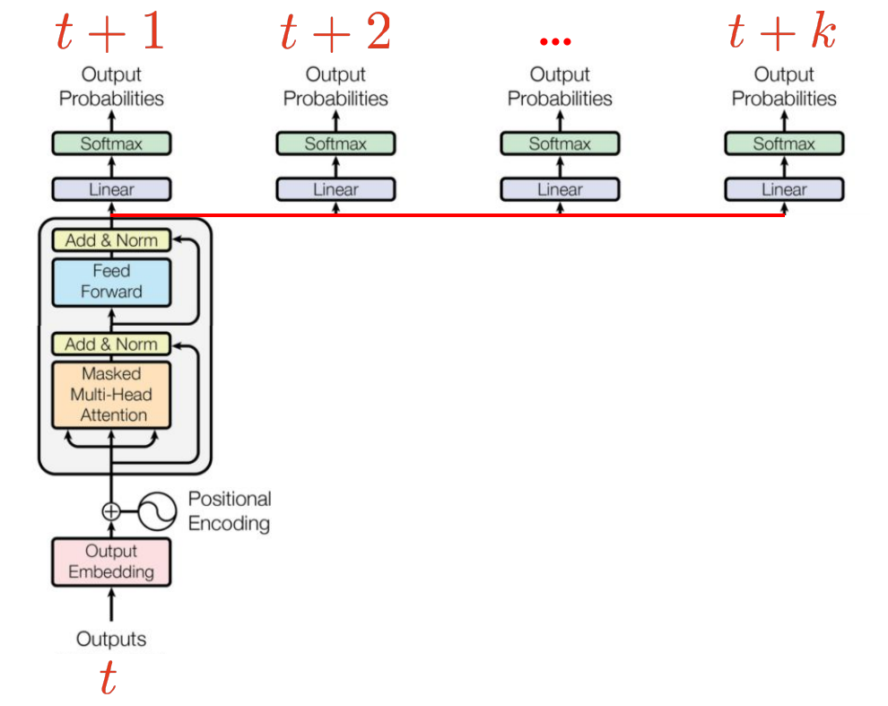

推論時，一次 forward pass 就能用額外的 head 猜出後面幾個 token，再用負責 $t+1$ 的 head 照 speculative decoding 的方式驗證，論文中以 4-token prediction 訓練的模型，推論速度最高可達 3 倍。

代價是模型必須用這種方式訓練，而且越遠的 head 預測越不準，被接受的機率也越低，所以 $k$ 不能無限增加。

## 總結

總結這堂課針對推論所提出的改善方案，分別對應到前面的兩個挑戰：在記憶體方面，PagedAttention 把向量管理得更有效率，GQA 與 MLA 讓向量變得更少、更小；在速度方面，speculative decoding 與 MTP 讓一次 forward pass 能產生更多 token。
